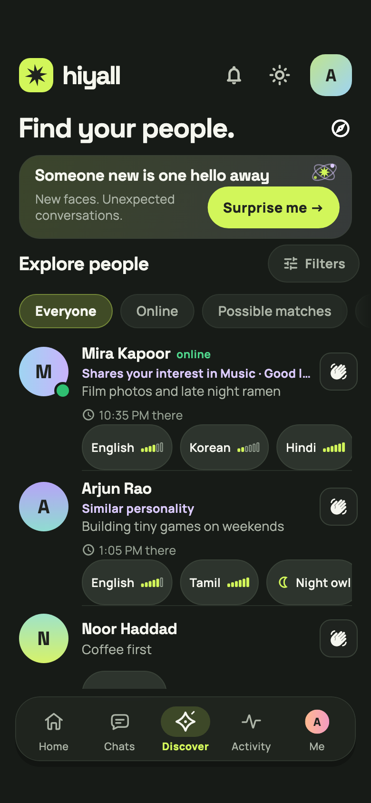
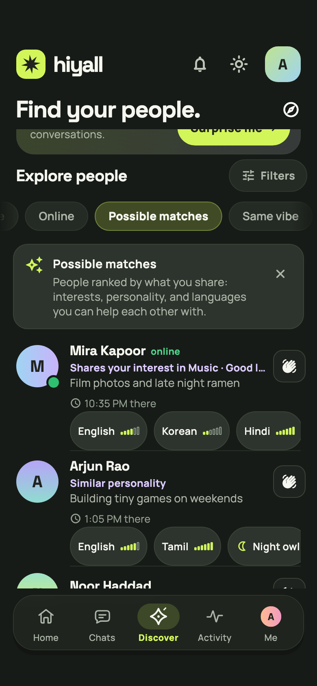
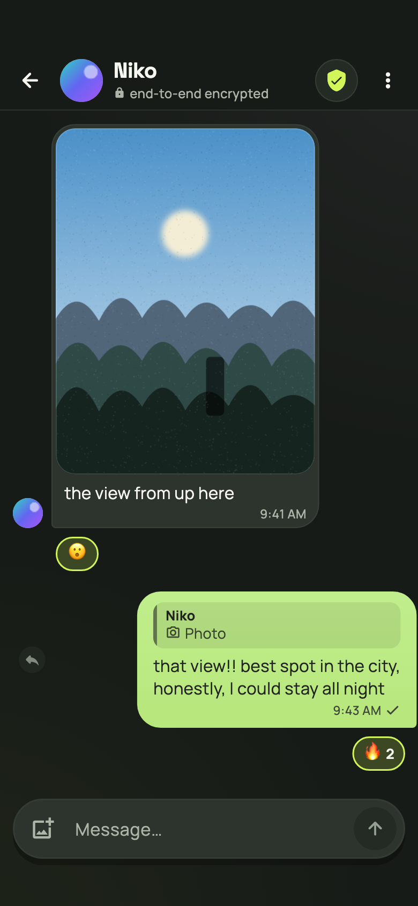
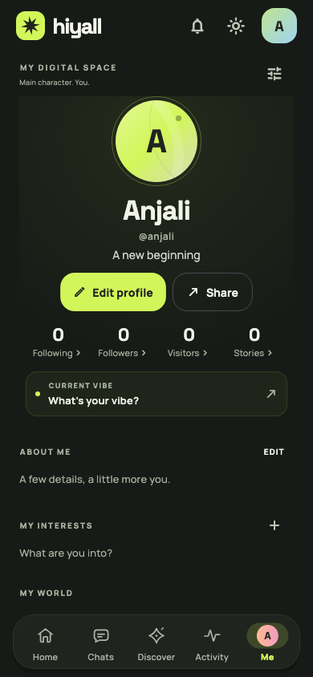
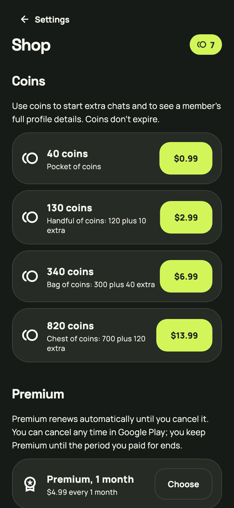

# Hiyall

Hiyall is a social and chat app for Gen Z: meet people through shared interests and languages, post short stories, and talk in end-to-end encrypted chats. It is open to anyone who says they are 13 or older. Members under 18 and adults are kept apart, and every member can block and report.

Flutter app (Android, iOS and a browser build) · Go API · PostgreSQL · Rust encryption core · React admin console.

> **Status: V1 release candidate, not launched.** The code and the automated tests are in place. It has not been tried on real phones, no store accounts or production services exist yet, and the legal documents under `docs/legal` are drafts. See [Remaining work](docs/development.md#remaining-work-and-release-boundary).

## Screenshots

These are rendered by the app's own widget tests with sample data (no real accounts). Regenerate them with the capture tests in `apps/mobile/test`.

| Discover | Possible matches | Chat |
|---|---|---|
|  |  |  |

| Profile | Shop (adults only, switched off by default) |
|---|---|
|  |  |

## What is in it

- **People:** profiles with language levels, interests, personality tags and a photo gallery; Discover with filters and ranked "possible matches"; opt-in Nearby with coarse, expiring locations; follows, friends, visitors and places visited.
- **Chat:** one-to-one and group chats (3 to 10 people) with end-to-end encryption (a Rust core on Olm), photos, voice messages, video, reactions, on-device translation, pinning and hiding chats.
- **Pulse:** stories and posts with topics, search, voice notes, threaded replies and notification preferences.
- **Safety:** age bands, blocks and reports, an admin and moderation console, notices board and a support inbox.
- **Account:** sign-in with Firebase, data export, account deletion, push notifications.
- **Money (built, off by default):** coins, premium and rewarded ads, adults only, behind `PLANS_ENFORCED`.

## Repository layout

| Path | What |
|---|---|
| `apps/mobile` | Flutter app (`rust/` holds the encryption core) |
| `apps/admin` | React and TypeScript moderation console |
| `services/api` | Go API, migrations runner, admin server, workers |
| `database` | SQL migrations and role grants |
| `packages/api-contracts` | Generated TypeScript types for the API |
| `config` | Example environment files (real ones are git-ignored) |
| `scripts` | Dev, test, release and operations scripts |
| `docs` | Architecture, API, mobile, security, legal and deployment documents |

## Run it locally

Nothing here needs a paid service. Secrets are never stored in the repository: you bring your own Firebase project, and photo storage is optional.

### 1. Install the tools

| Tool | Version used | For |
|---|---|---|
| Flutter | 3.47.6 (Dart 3.13) | the app |
| Go | 1.27.2 | the API |
| PostgreSQL | 16 (server and client binaries on `PATH`) | the database |
| Node.js | 24 | admin console, API contract tooling, Firebase CLI |
| Rust (stable) with `cargo` | 1.99 | the encryption core (needed for mobile builds and tests) |
| JDK 21 and the Android SDK | | Android builds only |
| Xcode and CocoaPods | | iOS builds only (macOS) |

The scripts start with `source scripts/env.sh`, which expects the tools under `$HIYALL_TOOLS_DIR` (default `~/.local/share/hiyall-tools`, versions in [toolchains.lock.json](toolchains.lock.json)). If yours are installed elsewhere, set `HIYALL_TOOLS_DIR` or edit `scripts/env.sh` so it points at your installs.

### 2. Get the code and dependencies

```bash
git clone https://github.com/democh-cyber/hiyall.git
cd hiyall
npm ci                                   # API contract tooling
cd apps/mobile && flutter pub get && cd ../..
```

### 3. Create your own Firebase project (for sign-in)

The app has no built-in test login, so real sign-in needs a Firebase project of your own.

```bash
npm install -g firebase-tools            # once
firebase login
./scripts/firebase-setup.sh <your-firebase-project-id>
```

This writes `config/firebase.local.json` (git-ignored). Enable the sign-in methods the app offers in the Firebase console; details are in [Sign-in and onboarding](docs/mobile/14-sign-in-and-onboarding.md#supplying-the-firebase-project). Without it the app still starts, but the Welcome screen says sign-in is not set up.

### 4. Start the API (terminal 1)

```bash
./scripts/dev-api.sh
```

This creates and starts a local PostgreSQL under `.runtime/`, applies all migrations, and serves the API at `http://127.0.0.1:8080`. Check it with `curl http://127.0.0.1:8080/healthz`.

### 5. Start the app in the browser (terminal 2)

```bash
./scripts/dev-mobile.sh
```

Open **http://localhost:49321**. The first load takes about a minute while the debug build compiles. Sign up with your Firebase project, finish onboarding, and you are in.

Chat and group chat only run in the Android and iOS apps, not in the browser build.

### 6. Optional: put people in Discover

A fresh database is empty. This adds 18 fake demo people (16 adults, 2 minors) to the local database only:

```bash
./scripts/dev/seed-demo-people.sh
```

The script refuses to run against any database other than the local `hiyall`.

### 7. Optional: run on an Android phone or emulator

```bash
source scripts/env.sh
adb reverse tcp:8080 tcp:8080            # phone: lets the app reach your API
cd apps/mobile
flutter run \
  --dart-define-from-file=../../config/firebase.local.json \
  --dart-define=API_BASE_URL=http://127.0.0.1:8080
```

An emulator can use `API_BASE_URL=http://10.0.2.2:8080` and needs no `adb reverse`. Plain http is only accepted by debug builds, and only for these local addresses.

### 8. Optional: the admin console

```bash
./scripts/dev-admin.sh operator-add -email you@example.com -role admin   # once: asks for a password, prints an authenticator secret
./scripts/dev-admin.sh                                                  # builds and serves the console
```

Open **http://127.0.0.1:8081**. Staff sign in with a password and an authenticator code. See [Moderation console](docs/development.md#moderation-console).

### 9. Optional: photos and push

Profile photos and chat attachments use two Cloudflare R2 buckets; push uses a Firebase service-account key. Without them those features answer "unavailable" and the rest works. Copy `config/media.example.env`, `config/chat-media.example.env` and `config/fcm-service-account.example.json` to the matching `*.local.*` names (all git-ignored), fill in your own values, and restart the API.

## Test it

```bash
source scripts/env.sh
createdb -h "$PWD/.runtime/pgsocket" -p 55432 -U hiyall hiyall_test         # once
createdb -h "$PWD/.runtime/pgsocket" -p 55432 -U hiyall hiyall_test_admin   # once, for the admin tests
export ADMIN_TEST_DATABASE_URL="postgresql://hiyall@/hiyall_test_admin?host=$PWD/.runtime/pgsocket&port=55432&sslmode=disable"
(cd services/api && DATABASE_URL="$ADMIN_TEST_DATABASE_URL" go run ./cmd/migrate)
./scripts/check.sh
```

`check.sh` runs the Go tests with the race detector, the Flutter analysis and tests, the Rust tests, the admin console tests, and the API contract and document checks. It takes about ten minutes.

## Release

`scripts/release-preflight.sh` lists every gate with a one-line fix. It fails on this tree on purpose, until the owner supplies the final legal text, store listing, production environment, signing keys and accounts. Follow the [release runbook](docs/deployment/12-release-runbook.md) and the [store submission checklist](docs/deployment/13-store-submission-checklist.md).

## Documentation

Start with the [review and traceability summary](docs/architecture/10-review-and-traceability.md) and [development setup and release boundaries](docs/development.md).

| Topic | Document |
|---|---|
| Product requirements | [Vision, personas, journeys, MVP](docs/architecture/01-product-requirements.md) |
| Architecture | [Modules, feed, chat, media, search](docs/architecture/02-technical-architecture.md) |
| Database | [Entities, indexes, growth](docs/database/03-database-design.md) |
| API | [Rules and inventory](docs/api/04-api-specification.md), [implemented contract](docs/api/openapi-foundation.json) |
| Mobile | [State, routing, storage, push, accessibility](docs/mobile/05-mobile-architecture.md) |
| UX | [Screens, flows, design system](docs/ux/07-ux-and-design-system.md), [Gen Z experience spec](docs/ux/08-gen-z-experience.md) |
| Security and privacy | [Threat model](docs/security/08-security-and-privacy.md), [encryption and interception](docs/security/11-encryption-and-interception.md), [group chat design](docs/mobile/19-group-chat.md) |
| Plans and limits | [Entitlements](docs/architecture/11-plans-and-entitlements.md), [billing API](docs/api/28-billing.md), [shop and ads](docs/mobile/18-shop-and-ads.md) |
| Operations | [Capacity and operations](docs/deployment/09-capacity-and-operations.md), [deploy guide](docs/deployment/10-deploy-guide.md) |
| Legal drafts | [docs/legal](docs/legal) (drafts, not reviewed by a lawyer) |

Run `python3 scripts/validate_architecture.py` to check document links and the OpenAPI structure.

## Security

Report vulnerabilities as described in [SECURITY.md](SECURITY.md). Do not commit keys, `*.local.*` files or anything under `.runtime/`; `.gitignore` already excludes them.
