# Hiyall product requirements

**Status:** Architecture draft; local foundation implementation authorized on 7 October 2026

**Date:** 2026-10-07

**Working codename:** Hiyall (not trademark-cleared)

## 1. Product vision

Hiyall helps people form meaningful, consent-based connections across interests, languages, and time zones. It combines a fast personalized social feed with bounded conversation spaces, private messaging, communities, and global discovery.

The product should feel premium and calm rather than noisy or addictive:

- fast on ordinary mobile networks;
- clear about why content and people are suggested;
- safe to explore before sharing personal information;
- respectful of privacy, accessibility, language, and local context;
- useful for both lightweight browsing and intentional conversation.

### Original product primitives

1. **Pulse** — the Home feed containing stories, posts, community highlights, and user-selected feed modes.
2. **Moments** — bounded, time-aware conversation spaces attached to a prompt, topic, event, or shared interest. A Moment can close or archive rather than becoming an endless feed.
3. **Interest Passport** — an opt-in profile of interests, languages, availability, and communities. Users can see and edit the signals used for discovery.
4. **Bridge Match** — a transparent overlap view showing shared interests, languages, communities, and time-zone convenience. It is not a sensitive-personality or attractiveness score.
5. **Language Bridge** — on-demand translation that preserves the original message and clearly labels the translated version.
6. **Quiet Controls** — quiet mode, digest notifications, reduced-activity views, and per-surface notification controls.

These primitives are intended to differentiate Hiyall from a follower-first feed, an open inbox, or a clone of an existing chat product.

## 2. Target users and personas

Owner decision, October 2026: Hiyall is for Gen Z and is not adult-only. The minimum age is a self-declared 13 and members get the same open defaults whatever their age; there is no separate youth experience. The earlier assumption here, that a youth experience would be a separate product and safety program, is superseded. What that leaves open for minors is written up in [Nearby and open access](../api/19-nearby-and-open-access.md#safety-note-for-the-owner), as recommendations that are not implemented.

### 2.1 Global Bridge Builder

An international student, traveller, expat, or remote worker who wants authentic cross-border connections. Needs translation, time-zone awareness, low-bandwidth behavior, and strong controls over who can contact them.

### 2.2 Quiet Participant

Someone who likes social interaction but dislikes public performance and notification pressure. Wants to browse, join bounded conversations, participate asynchronously, and leave without social penalty.

### 2.3 Conversation Host

Someone who creates a prompt, discussion, language exchange, event, or interest-led Moment. Needs audience controls, capacity, moderation tools, scheduling, and an easy way to close or archive the space.

### 2.4 Trusted Connector

Someone who wants to continue a promising shared conversation privately. Expects mutual consent before a new direct chat opens and wants transparent safety controls.

### 2.5 Community Builder

An organiser who needs a durable community, roles, events, announcements, and moderation without exposing unnecessary private conversations to staff.

## 3. Product principles

1. **Conversation before broadcasting.** Pulse supports posts, but Moments and replies provide context and a reason to connect.
2. **Consent is a first-class state.** Follow, friend, message, mention, discovery, and visibility are independently controllable.
3. **The user can explain the recommendation.** Every Bridge Match and major feed suggestion has a human-readable reason such as “3 shared interests” or “same community.”
4. **Original language remains visible.** Translation is optional, reversible, and never silently replaces user-authored text.
5. **Bounded attention.** Quiet mode, digesting, and closing/archiving Moments are part of the product model.
6. **Safety ships with social features.** Block, mute, restrict, report, rate limits, moderation, and appeals are not post-launch add-ons.
7. **Privacy is regional and operational.** Data retention, residency, deletion, export, and operator access are modeled rather than described only in policy text.
8. **Accessibility is part of the component contract.** Dynamic type, screen readers, reduced motion, colour contrast, keyboard support where relevant, and RTL are acceptance criteria.

## 4. Information architecture and navigation

The primary mobile navigation has five destinations:

| Tab | User-facing label | Primary job |
|---|---|---|
| 1 | Home / Pulse | Stories, personalized feed, feed controls; Moments in the advanced phase |
| 2 | Chats | Direct chats, group chats, message requests, and call entry points |
| 3 | Discover / Bridge | Find Friends, search, communities, events, and recommendations |
| 4 | Notifications | Grouped social, message, community, security, and moderation updates |
| 5 | Profile | Own profile, posts, highlights, settings, privacy, and security |

Stories remain at the top of Home. They are not a sixth bottom-tab destination.

### Core navigation map

```mermaid
flowchart TD
  Home[Home / Pulse] --> Stories[Stories tray]
  Home --> Feed[Personalized feed]
  Home --> Moment[Moment detail]
  Home --> Create[Create post or story]
  Chats[Chats] --> DM[1:1 chat]
  Chats --> Group[Group chat]
  Chats --> Calls[Voice/video calls]
  Discover[Discover / Bridge] --> Find[Find Friends]
  Discover --> Search[Global search]
  Discover --> Communities[Communities]
  Discover --> Events[Events]
  Notifications[Notifications] --> DeepLink[Deep-linked object]
  Profile[Profile] --> Privacy[Privacy Center]
  Profile --> Security[Sessions and security]
```

## 5. Functional requirements

### 5.1 Identity and onboarding

- Email, phone, Google, Apple, and passkey sign-in where available.
- Secure verification with expiry, retry limits, and abuse controls.
- Display name and username; public identity is not required to equal legal identity.
- Optional profile picture, bio, languages, location, profession, education, interests, and pronouns.
- Language, time zone, notification, discovery, and privacy choices during onboarding.
- Locale-aware dates, numbers, and currencies; currency is represented as ISO 4217 plus integer minor units for future commerce, even though monetisation is out of MVP.
- Account export, deactivation, deletion, session management, and logout-all-devices.
- No unnecessary required fields; every optional field has a visibility setting.

### 5.2 Home, stories, and Pulse

- Stories tray with add-story, viewed/unviewed state, expiry, privacy audience, close friends, highlights, replies, mentions, polls, questions, music, location stickers, and emoji reactions.
- Default story expiry is 24 hours; the author may choose 6, 12 or 24 hours (the server validates the choice against the member's entitlements, `docs/architecture/11-plans-and-entitlements.md`), the server owns expiry and the client renders it.
- Pulse supports text, image, video, carousel, poll, question, link, location, music, temporary, repost, and shared posts.
- Post actions: like, typed reaction, comment, threaded reply, share, repost, save, report, hide, not interested, and copy link.
- Cursor pagination, pull-to-refresh, skeleton states, optimistic low-risk actions, offline cache, lazy media, and bounded page sizes.
- Feed modes: Friends, Following, Communities, Global, and Trending. User-selected mode is preserved per device/account.
- Feed ranking exposes a lightweight reason and always applies block, privacy, moderation, and not-interested filters before ranking.

### 5.3 Moments — advanced phase

- Create a bounded conversation around a topic, event, language exchange, or interest.
- Configure audience (invite-only, community, interest-based, public), languages, capacity, start/end time, and moderation level.
- Support read-only preview, participation approval, pinned context, replies, reactions, translation, and host controls.
- A Moment can be closed, extended, or archived; archived Moments are read-only unless explicitly reopened.
- “Continue privately” opens a consent request rather than an unsolicited direct message.

### 5.4 Chats and calls

- 1:1 and group text chat with text, emoji, GIF, sticker, image, video, audio, file, contact, location, voice message, reply, forward, edit, delete, reactions, mentions, search, pin, save, disappearing messages, scheduled messages, drafts, translation, and spam controls.
- Message lifecycle is explicit: sending, sent/durable, delivered, read, failed.
- Typing, online, last seen, read receipts, drafts, message requests, mute, restrict, and per-chat notification controls.
- Groups include avatar, description, admins, moderators, permissions, invite links, join requests, pinned messages, polls, events, member management, and searchable media.
- Voice/video architecture uses WebRTC with STUN/TURN, adaptive bitrate, reconnect, network switching, device controls, and no media proxying through the application API.
- Call history is metadata-only by default; recordings are not implied by call support.

### 5.5 Bridge / Find Friends

- Search by name, username, country, state/province, city, language, interests, profession, education, industry, skills, hobbies, verification, activity, mutual connections, communities, content interests, and account type where safe and voluntarily disclosed.
- Never expose sensitive or discriminatory attributes as filters.
- Categories: People You May Know, Mutual Connections, Similar Interests, Same Communities, Nearby (opt-in), New Users, Popular Creators, Suggested Friends, Similar Follows, Professional Connections, and Global Discover.
- Interest Passport lets a user select, remove, and control the visibility of interests.
- Bridge Match shows explainable overlap, not a hidden human-value score. Example: “4 shared interests and 1 shared community.”
- Nearby is coarse, privacy-controlled, and never exposes exact location.
- Search and recommendation results are bounded, paginated, safety-filtered, and re-rankable without changing the transactional source of truth.

### 5.6 Profiles and relationships

- Profiles include avatar, cover, name, username, bio, optional pronouns/location/website, interests, skills, profession, education, followers, following, friends, posts, stories/highlights, media, and reposts.
- Actions: follow, friend request, message request, share, block, report, restrict, and mute.
- Visibility can be public, friends-only, followers, private, or field-specific.
- Privacy Center controls who can message, follow, friend-request, see stories/activity/location/online status/last seen, comment, mention, and discover the account.
- Block and privacy decisions are enforced server-side across search, feed, chat, notifications, recommendations, media URLs, and cached projections.

### 5.7 Notifications

- In-app and push notification center with deep links.
- Types include friend request, follow, reaction, comment, reply, mention, message, story reply, group/community invitation, security, and account activity.
- Aggregate and batch high-volume events; do not emit one push for every reaction.
- Per-type, per-surface, quiet-hours, digest, and device preferences.

### 5.8 Communities and events

- Communities are public, private, or invite-only.
- Roles: owner, admin, moderator, member.
- Community posts, topics, polls, events, rules, moderation queue, member controls, and search.
- Events have title, description, time zone, date/time, physical/online location, RSVP, attendee visibility, reminders, sharing, and event chat.
- Time-zone-safe display stores UTC plus the event's IANA zone and preserves the organiser's intended local time.

### 5.9 Safety, moderation, and privacy

- Report users, posts, messages, stories, communities, comments, and events.
- Reasons: spam, harassment, scam, hate, threats, sexual content, violence, impersonation, copyright, and other.
- Admin console provides queue, evidence, history, suspensions, bans, appeals, moderator actions, audit trail, and least-privilege access.
- Automated risk/moderation signals triage content; uncertain or high-impact decisions require human review.
- Never expose unnecessary private message content to administrators; access to restricted evidence is audited and policy-bound.
- Data export, deletion workflow, regional retention, legal holds, consent records, and connected session/device management.

### 5.10 Optional AI features

- Translate, improve, summarize, or rewrite only after an explicit user action.
- Always preserve the original message and label generated output.
- AI moderation detects spam, harassment, hate, threats, sexual exploitation, scams, malicious content, and bot-like behaviour; it does not make irreversible high-impact decisions alone.
- Recommendations may use declared interests, communities, follow graph, and content similarity, but not sensitive attributes.
- AI providers are isolated behind a policy-controlled gateway with regional routing, retention controls, redaction, cost budgets, and audit events.

## 6. Key user journeys

### Journey A — first meaningful connection

1. User signs up and chooses language, time zone, interests, discovery mode, and privacy defaults.
2. Home shows stories and Pulse posts; Discover shows opt-in people with shared-interest reasons.
3. User previews a profile and sends a bounded message request.
4. The recipient accepts, declines, ignores, blocks, or reports without opening an active chat.
5. On acceptance, both can send messages and see durable delivery state.
6. In the advanced phase, Moments provide hosted shared conversations and private continuation; translation remains optional and preserves original text.

### Journey B — create a safe social post

1. User chooses post type and adds media through a resumable direct upload.
2. Client displays the selected audience and fields that may reveal location.
3. Server validates policy, media, visibility, and mentions before publishing.
4. Feed/search/notification projections update asynchronously.
5. User can edit, hide, save, report, or delete; deletion becomes a distributed workflow.

### Journey C — low-bandwidth chat

1. Client reads cached conversation history and drafts locally.
2. Message is added to a durable local outbox with a client idempotency key.
3. When connectivity returns, the client sends the command, reconciles the server sequence, and removes the outbox entry.
4. Reconnect resumes from the last acknowledged cursor; duplicate events are ignored by message ID/sequence.

### Journey D — privacy recovery

1. User opens Privacy Center, blocks an account, and requests data export or deletion.
2. Block takes effect synchronously for new authorisation decisions.
3. A deletion saga removes or tombstones source data, caches, search documents, feed entries, notifications, media derivatives, and analytics identifiers according to policy.
4. User sees status and any retention/legal-hold exception without being shown internal system details.

## 7. MVP scope

### Must ship in MVP

- Flutter Android/iOS shell with accessibility, light/dark themes, localization foundations, RTL support, and error/empty/loading states.
- Email/phone/OIDC authentication, session/device management, and account recovery.
- Profile, privacy defaults, Interest Passport, language/time zone, and block/mute/report.
- Home Pulse with photo/video/text stories, text/image/video/carousel posts, reactions, comments, saves, OS/link share, cursor pagination, offline cache, and media upload. Private cross-chat share/forward, polls/music/stickers and disappearing/scheduled messages are advanced features.
- Consent-based message requests with accept/decline/block; a stranger cannot create an active direct chat merely by supplying member IDs.
- End-to-end encrypted 1:1 chat and chat attachments with device identity verification, message states, delivery/read receipts, typing, encrypted reactions/replies/edits, drafts, reconnect and offline retry. No automatic plaintext chat processing on the server.
- Follow/friend requests, Find Friends, explainable interest/community recommendations, and global user search.
- Grouped in-app/push notifications and deep links.
- Basic moderation queue, automated triage hooks, account actions, appeals records, and audit logs.
- Data export/deletion request workflow and privacy/security settings.
- Observability baseline: structured logs, metrics, tracing, audit, crash reporting, and SLO dashboards.

### Explicitly later than MVP

- Moments with timed participation, host controls, and consent-based continuation.
- Group voice/video beyond a small WebRTC pilot.
- Large public communities, creator monetisation, advertising, and marketplace features.
- Full event lifecycle and event chat.
- Advanced OpenSearch ranking, machine-learned recommendations, and large-scale feed fanout.
- E2EE group/call protocols and optional user-key encrypted backup; direct-chat and attachment E2EE are mandatory MVP security requirements.
- Regional active-active writes and youth-specific experiences.

## 8. Phased roadmap

| Phase | Outcome | Major additions |
|---|---|---|
| 0 — foundation | Safe architecture and first vertical slice | Contracts, auth, profile, design system, observability, migrations |
| 1 — MVP | Meaningful social + chat loop | Pulse, stories, 1:1 chat, Bridge, notifications, safety |
| 2 — richer spaces | Durable communities and events | Moments, groups, communities, events, moderation operations, voice/video pilot |
| 3 — global intelligence | Better cross-language discovery | Translation, explainable ranking, recommendation pipelines, creator tools |
| 4 — scale cells | Multi-region operation | Regional ownership, sharded data, search/feed projections, DR exercises |

## 9. Success metrics

### North-star metric

**Weekly meaningful cross-border conversations:** a conversation involving people with different countries or language preferences, at least three human message turns, and no unresolved high-severity safety intervention.

### Activation and quality

- onboarding completion;
- percentage following a person or sending a consent request within 24 hours;
- time to first meaningful reply;
- seven-day return after first conversation;
- mutual-consent private connection rate;
- translation success and correction rate;
- message durable-ack and delivery latency;
- cache/offline recovery success;
- report and block rates per 1,000 messages;
- high-severity report time-to-action;
- appeal false-positive rate;
- accessibility task completion and crash-free sessions.

Measure cross-border participation only from voluntarily provided coarse country/language data and aggregated metadata, never inferred precise location or message bodies.

Initial targets are hypotheses for research validation, not production guarantees: 40% onboarding-to-first-discovery in 24 hours, 25% first-message rate in 24 hours, 95th-percentile message delivery below two seconds in launch regions, and 99.5% crash-free sessions.

## 10. Non-goals and guardrails

- Do not build an infinite media feed as the only core loop.
- Do not make public follower counts, streaks, or leaderboards the primary incentive.
- Do not open unsolicited DMs by default.
- Do not expose exact location or sensitive personal attributes for discovery.
- Do not claim end-to-end encryption before protocol, key lifecycle, multi-device, recovery, and moderation designs are complete.
- Do not use small load tests as proof of 100M-user readiness; capacity claims must be tied to measured requests/sec, messages/sec, concurrent sockets, media GB/day, and follower distributions.

## 11. Product decisions requiring approval

1. Approve Hiyall as a provisional codename and confirm final brand work is separate.
2. Decided: not adult-only (minimum age 13, self-declared). Age bands (minors and adults kept apart) and stricter minor defaults are now implemented on a self-declared birth date; still open: moderation staffing, parental consent, COPPA/GDPR-K review, age assurance and content restrictions for minors; see the safety note in `docs/api/19-nearby-and-open-access.md`.
3. Confirm the Moment + Pulse combination as the original information architecture.
4. Direct-chat/attachment E2EE is now required by the user. Review the device-key/recovery, local search, consent-based evidence and interception-test design before chat implementation.
5. Confirm launch regions, supported languages, data-residency constraints, and the initial cloud account/region.
