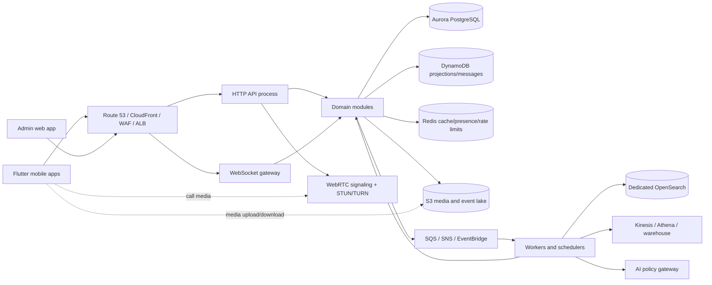
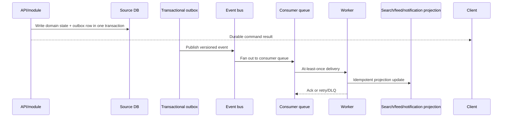
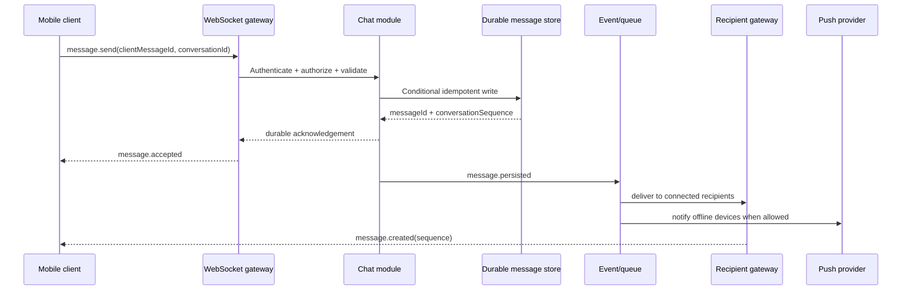
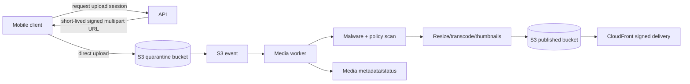

# Kairova technical architecture

**Status:** Architecture draft; local foundation implementation authorized on 7 October 2026

**Primary client:** Flutter for Android and iOS

**Concrete cloud:** AWS, using managed services where operationally justified

**Default deployment posture:** one region, Multi-AZ, modular monolith first; regional cells later

## 1. Executive architecture decision

Kairova starts as a **modular monolith with independently scalable runtime processes** rather than dozens of microservices:

```text
One repository / strict domain modules
        |
        +-- HTTP API process
        +-- WebSocket gateway process
        +-- background worker process
        +-- scheduler / maintenance process
        +-- isolated admin API process
```

The modules own their data access and emit versioned domain events through a transactional outbox. High-volume or operationally sensitive modules can later be extracted behind the same contracts.

### Initial technology choices

| Concern | Initial choice | Scale-out path |
|---|---|---|
| Mobile | Flutter, Dart, Riverpod, Drift/SQLite | Feature packages and native plugins |
| Public API | Go service, `chi`-style HTTP routing, REST/JSON, OpenAPI contracts | Extract modules or add GraphQL/BFF only when measured useful |
| Real-time | WebSocket gateway + durable chat writes | Regional gateway fleet and conversation home regions |
| Core transactions | Aurora PostgreSQL Multi-AZ | Sharded Aurora clusters and regional ownership |
| High-volume ordered data | DynamoDB for messages/feed projections when justified | Regional tables / selective Global Tables |
| Cache/ephemeral | ElastiCache Redis | Regional Redis; never system of record |
| Async work | SQS, SNS, EventBridge, transactional outbox | Kinesis/MSK for high-volume ordered streams |
| Object media | S3 private buckets + CloudFront | Replication, lifecycle tiers, regional edge policies |
| Search | Dedicated OpenSearch at MVP | OpenSearch projections with rebuilds |
| Analytics | Kinesis/S3 data lake/Athena | Warehouse/lakehouse and model feature pipelines |
| Compute | ECS Fargate behind ALB/NLB | ECS capacity or EKS only when operations justify it |
| IaC/CI | Terraform + GitHub Actions OIDC | Multi-account, progressive delivery, policy as code |

### Concrete stack assumption

Because this workspace contains design documents and no backend stack was supplied, the implementation default is **Go for API/realtime/workers**, using generated OpenAPI types, `pgx`/SQL query generation, and the standard library plus small focused packages. The admin console default is **TypeScript/React**. Go is selected for predictable concurrency, efficient WebSocket/worker processes, and small container footprints; this is an implementation choice, not a requirement that future teams cannot change. These are defaults, not claims that the system is already implemented or production-ready.

## 2. Architecture goals and constraints

### Goals

- Provide a complete, safe vertical slice for the MVP without premature distributed-system complexity.
- Preserve clear seams for independently scaling chat, media, notifications, search, feed, recommendations, and trust/safety.
- Support low-bandwidth and intermittently connected mobile clients.
- Make privacy, deletion, data residency, moderation, audit, and operator access explicit data flows.
- Support a measured path from 1,000 users to 100M+ registered users.
- Keep public API contracts versioned, bounded, observable, and idempotent.

### Constraints and assumptions

- The first launch has one primary write region and Multi-AZ failure tolerance.
- Registered users are not a capacity plan. Capacity is driven by peak DAU/MAU, requests/sec, concurrent sockets, messages/sec, feed fanout, media GB/day, and hot-key/follower distributions.
- Direct chats and private chat attachments require E2EE from launch. Servers relay ciphertext and minimized delivery metadata. Public/social content remains server-processed under TLS, encryption at rest and authorization. The updated requirement is in `docs/security/11-encryption-and-interception.md`; protocol/library integration review precedes chat code.
- All data access decisions are server-side; client visibility is never an authorization boundary.
- All asynchronous delivery is treated as at-least-once. Idempotency is an application property.

## 3. Logical architecture



### Data ownership rule

Each module owns its tables, repositories, validation, authorization policy, and events. Other modules must not issue direct queries against those tables. Cross-module reads use an application query or read model; cross-module writes use commands or events.

### Initial domain modules

| Module | Owns | Extraction trigger |
|---|---|---|
| Identity and access | accounts, auth identities, sessions, devices, roles | security isolation or auth scale |
| Profiles and privacy | profile, settings, visibility, consent, data lifecycle | independent privacy/data-residency ownership |
| Social graph | follows, friends, blocks, mutes, restricts | graph volume or recommendation load |
| Content | posts, comments, reactions, saves, mentions | post/interaction write scale |
| Feed | candidates, ranking, materialized timelines | fanout/ranking latency |
| Stories | story lifecycle, views, highlights, replies | expiry/view traffic |
| Moments | bounded spaces, participation, hosts, prompts | community/space scale |
| Chat | conversations, members, messages, receipts, drafts | hot conversations and sockets |
| Media | upload sessions, assets, transforms, scan state | storage/processing isolation |
| Notifications | preferences, in-app items, aggregation, push jobs | push volume and provider isolation |
| Search | indexing and query projections | search cluster scale |
| Recommendations | candidate generation, features, ranking, experiments | model/retrieval scale |
| Trust and safety | reports, risk signals, actions, appeals, audit | case volume and access isolation |
| Communities/events | community membership, roles, events, RSVP | independent traffic patterns |
| Analytics | event ingestion, aggregation, exports | data platform ownership |
| Administration | support workflows and privileged access | separate security boundary |

The first release may deploy all of these in one codebase, but module boundaries are enforced in code review, tests, and dependency rules.

## 4. Runtime and AWS deployment

### 4.1 Initial regional topology

```text
Route 53
  -> CloudFront (public/cacheable media and edge controls)
  -> WAF
  -> ALB for HTTPS API / NLB or ALB WebSocket target
       -> ECS Fargate private services across 3 AZs
            - api
            - websocket-gateway
            - worker
            - scheduler
            - admin-api (separate service/security group)
  -> private data subnets
       - Aurora PostgreSQL Multi-AZ + read replica
       - ElastiCache Redis replication group
       - VPC endpoints to S3/DynamoDB/SQS/ECR
```

### 4.2 AWS service map

| Layer | AWS choice | Design notes |
|---|---|---|
| DNS/routing | Route 53, Global Accelerator later | Health checks and regional routing are later-phase features |
| Edge/security | CloudFront, WAF, Shield, ACM | CDN for media; WAF is not the only abuse control |
| Compute | ECS Fargate + ECR | Separate scaling policies for HTTP, sockets, workers, admin |
| Relational data | Aurora PostgreSQL | Private subnets, KMS, PITR, read replicas |
| Key/value data | DynamoDB | Access-pattern-driven, TTL where safe, conditional writes |
| Cache | ElastiCache Redis | TTLs, bounded memory, regional presence/rate limits |
| Object storage | S3 | Quarantine and published buckets, versioning, lifecycle, replication |
| Async | SQS/SNS/EventBridge | Per-consumer queues and DLQs; Kinesis later for high-volume streams |
| Search | Dedicated OpenSearch from MVP | Search index is rebuildable and never source of truth |
| Calls | Signaling API + managed TURN/STUN or approved provider | Media does not traverse the application API |
| Secrets/keys | Secrets Manager, KMS, IAM | No secrets in mobile builds or repository |
| Observability | CloudWatch + ADOT/OpenTelemetry | Central log retention and redaction |
| Delivery | GitHub Actions OIDC, Terraform, CodeDeploy | No long-lived cloud keys in CI |

ECS is preferred over Kubernetes at the beginning because the product needs scalable containers but not necessarily a self-managed control plane. EKS becomes reasonable only after team capability, service count, deployment needs, and platform economics justify it.

### 4.3 Environment separation

- Separate AWS accounts for development, staging, production, and security/logging.
- Separate VPCs and KMS keys per environment.
- Production access is role-based, time-bound, audited, and break-glass only when necessary.
- CI uses OIDC role assumption, not stored AWS access keys.
- Production data is never copied into developer environments without approved minimisation and anonymisation.

## 5. Scale path

### Stage A — 1,000 to 100,000 registered users

- One region, three AZs, ECS Fargate, Aurora PostgreSQL, Redis, S3/CloudFront, SQS/EventBridge.
- PostgreSQL is the source of truth for identity, profiles, graph, posts, stories, Moments, and early chat.
- Dedicated OpenSearch runs separately from the transactional database; local development uses a container. This follows the brief’s separate-search requirement despite the additional operating cost.
- Feed entries may be a partitioned PostgreSQL table or Redis-backed cache; all are rebuildable.
- Use a single WebSocket fleet with connection limits, heartbeats, resume cursors, and push fallback.

### Stage B — 100,000 to 5M registered users

- Add Aurora read replicas and partition high-volume tables.
- Move messages, unread/read state, and feed materialization to DynamoDB when access patterns and load measurements justify it.
- Introduce OpenSearch for user/content search.
- Extract media, notification, chat gateway, and search workers when their scaling or fault domains diverge.
- Add Kinesis for product events and recommendation features.
- Test cross-region backups and partial failover; do not claim active-active yet.

### Stage C — 5M to 100M+ registered users

- Adopt regional cells with explicit home-region ownership for users and conversations.
- Use sharded Aurora or multiple PostgreSQL clusters for transactional domains.
- Use regional DynamoDB tables/Global Tables only for data with defined conflict semantics.
- Route sockets to the conversation's or user's home region; reconnect from a durable cursor.
- Use Kinesis/MSK only where ordered high-volume streams justify the operational cost.
- Maintain replayable S3 event history to rebuild feed, search, recommendation, and analytics projections.
- Use active-active at the edge while keeping writes region-owned where cross-region transactions would be unsafe.

### Capacity inputs required before each stage

- Peak and sustained requests/sec by endpoint class.
- Peak concurrent WebSocket connections and reconnect storms.
- Messages/sec, message size, receipt fanout, and hot-conversation distribution.
- Post/story publish rate and follower distribution, including high-follower authors.
- Media uploads, transformed GB/day, CDN hit rate, and egress.
- Search QPS, indexing lag, query latency, and result visibility filters.
- Queue depth/age, worker throughput, retry rate, and DLQ rate.
- Cost per DAU and cost per media GB.

## 6. Consistency and reliability policy

### Strong consistency required for

- Account ownership and authentication.
- Authorization, privacy, block, restrict, and membership decisions.
- Durable message acknowledgement.
- Idempotency outcomes.
- Moderation actions and account status.
- Data export/deletion state transitions.

### Eventual consistency acceptable for

- Feed materializations and rankings.
- Search indexes and suggestions.
- Recommendation candidates and compatibility overlaps.
- Reaction counters and notification counts.
- Presence and last-active hints.
- Analytics and dashboards.

### Reliability rules

- Every retried command has an idempotency key or a deterministic deduplication key.
- Every emitted domain event has a schema version and stable event ID.
- Every consumer tolerates duplicates, delay, out-of-order delivery, and replay.
- Every projection has a rebuild/backfill path from source data or durable events.
- Redis loss must degrade performance, not destroy source-of-truth state.
- A failed optional dependency must have a bounded fallback: chronological feed, no translation, cached profile, or queued notification.

## 7. Event architecture



### Event envelope

```json
{
  "id": "evt_01J...",
  "type": "post.published",
  "version": 1,
  "occurredAt": "2026-10-06T12:00:00Z",
  "producer": "content",
  "aggregateType": "post",
  "aggregateId": "post_01J...",
  "traceId": "trace_01J...",
  "data": {}
}
```

Initial events include `user.created`, `profile.updated`, `follow.created`, `friendship.changed`, `post.published`, `post.deleted`, `story.published`, `message.persisted`, `media.ready`, `report.created`, `moderation.actioned`, `notification.requested`, and `user.deletion.requested`.

## 8. Real-time messaging architecture

### 8.1 Message write and delivery path



Required behavior:

- Client-generated idempotency key prevents duplicate sends after timeout/retry.
- Conversation-level sequence provides ordering within one conversation; there is no global message ordering promise.
- WebSocket heartbeats, idle timeout, bounded per-connection queues, backpressure, and exponential reconnect with jitter.
- Reconnect resumes from the last acknowledged event/message cursor.
- Clients de-duplicate by event ID and message ID/sequence.
- Push is a wake-up/fallback path, not a durable source of message truth.
- Presence is TTL-based and approximate. “Online” is not a security or delivery guarantee.
- Large group fanout uses queue-based delivery and per-recipient cursors, not a synchronous loop in the request path.

### 8.2 Mandatory encrypted-chat boundary

The user's updated requirement makes direct-chat and chat-attachment E2EE mandatory for messaging launch. TLS and KMS source encryption remain separate controls. Use a maintained, reviewed established protocol/library through native adapters; no custom cryptography or mobile shared decryption secret. Device identity verification, directory authenticity, device add/remove, lost-key recovery, encrypted local ratchet/outbox state and ciphertext attachment handling must pass integration review before chat implementation.

The API, socket, source message store and outbox carry device-specific ciphertext, not rendered message bodies. A stock release should reject ordinary unauthorized proxy interception; controlled instrumented endpoints can still observe their own data. Public posts/profile/search/account operations remain server-visible inside TLS. This is not a promise that every request, routing detail or on-device plaintext is invisible.

Server-side chat search/content moderation/translation is removed; use local processing and explicitly shared report evidence. Encrypted private attachments bypass server transcoding/content scan because the server has no decryption key; client preparation and safe recipient decoding are required. Public media retains its quarantine/scan pipeline. See [encryption lifecycle and release tests](../security/11-encryption-and-interception.md).

## 9. Feed and story architecture

### 9.1 Hybrid feed

Canonical posts and stories live in the Content/Stories module. Pulse is a rebuildable read model.

- **Fan-out on write** for ordinary authors with a bounded follower count.
- **Fan-out on read** for high-follower authors and high-volume public accounts.
- **Hybrid candidate merge** for viewers following many high-volume sources.
- Separate “new posts” from ranked recommendations so ranking failure has a clear fallback.
- Apply privacy, blocks, mutes, moderation, audience, expiry, and not-interested filters before ranking.
- Cap materialized items per viewer, use TTLs, and make insertion idempotent.
- Use cursor pagination whose opaque cursor carries the ranking version and boundary, not a raw offset.

### 9.2 Ranking inputs

Initial deterministic ranking uses recency, relationship strength, explicit interests, community membership, quality signals, and negative feedback. Later models may use cached features and experiments but must record:

- candidate source;
- reason code shown to the user;
- model/ranking version;
- feature policy/consent version;
- fallback reason when model or feature retrieval is unavailable.

Stories are expiry-driven and should not require a full feed rebuild when they disappear. A scheduled expiry worker and read-time expiry check provide defence in depth.

## 10. Media architecture

The scan/transcode diagram and rules below describe server-visible social media. Encrypted chat media follows a separate client-encrypt → direct ciphertext upload → recipient-decrypt path in `docs/security/11-encryption-and-interception.md`; the server cannot scan or transcode that content.



Rules:

1. API validates declared size, type, quota, and policy before issuing a short-lived upload session.
2. Client uploads directly to a private quarantine bucket using multipart/resumable transfer.
3. Worker checks checksum, actual MIME type, malware, metadata, and moderation state.
4. Image EXIF is stripped unless a user explicitly needs a safe subset.
5. Video produces thumbnails and adaptive variants asynchronously; MediaConvert or an equivalent managed pipeline is preferred.
6. Published assets have immutable IDs and signed CloudFront URLs/cookies; object keys contain no private user data.
7. Deletion creates a tombstone and asynchronously removes derivatives, caches, indexes, feed references, and retained copies according to policy/legal hold.
8. Storage classes and lifecycle rules control cost; originals are retained only when required.

## 11. Search and discovery

### Search evolution

1. MVP: dedicated OpenSearch projections for opt-in profiles and eligible public posts; prefix/typo queries are bounded.
2. Growth: extend projections to communities, hashtags, topics, and events; scale shards from measured index size and query load.
3. Scale: regional indexes, alias-based reindexing, async delete propagation, and query routing by residency/home region.

Search documents are never the source of truth. Every document includes visibility/version fields for candidate filtering. The API re-authorizes and hydrates each candidate from authoritative policy before returning fields; index flags alone cannot reject a stale privacy change. Apply the same checks to suggestions, totals, facets, and snippets; do not expose raw search totals. Full reindex and delete/tombstone replay are required before OpenSearch is introduced.

Private message bodies cannot be indexed by the server under the mandatory E2EE design. Use encrypted local search; no plaintext search index or server message key escrow.

### Recommendation pipeline

```text
API/mobile events
  -> Kinesis or batch collector
  -> partitioned S3 event lake
  -> Glue/Athena or warehouse
  -> offline features and evaluation
  -> model registry / policy review
  -> cached online features
  -> recommendation module
```

Evolution path: rules and popularity → declared-interest/social-graph ranking → content similarity → controlled learned ranking. Recommendation failure degrades to explicit-interest and chronological candidates. Deletion and consent changes must flow into training datasets, features, caches, and evaluation exports.

## 12. Notification architecture

- Domain events create `notification.requested` records rather than sending synchronously in product requests.
- Notification module applies user/device preferences, block state, quiet hours, locale, and deduplication.
- High-volume events are coalesced: “A, B, and 12 others reacted” instead of 14 pushes.
- In-app notifications are durable and cursor-paginated; push payloads contain minimal data and a deep-link ID.
- Provider failures use bounded retry, token invalidation, and a dead-letter queue.
- Security, login, account recovery, and moderation actions bypass ordinary social batching only when policy requires it.

## 13. Security and privacy architecture

### 13.1 Identity and sessions

- Use an OIDC-compatible identity provider or a carefully isolated Identity module.
- Access tokens are short-lived; refresh tokens rotate and are revocable per device/session.
- Support passkeys plus verified email/phone recovery, MFA, risk-based challenges, and credential-stuffing detection.
- Store refresh/session material only in iOS Keychain or Android Keystore-backed secure storage; never plain local storage.
- Maintain device/session records, last-used metadata, revocation state, and “log out all devices.”
- Administrative authentication is separate from consumer authentication and requires stronger assurance.

### 13.2 Authorization

Every object access checks:

1. authenticated principal and account status;
2. object visibility and audience;
3. relationship/membership and role;
4. block/mute/restrict state;
5. regional/data-residency policy;
6. moderation/takedown state;
7. field-level minimisation.

Route guards are not sufficient. The domain layer enforces BOLA/IDOR resistance and cannot trust user-supplied owner IDs.

### 13.3 Privacy lifecycle

- Separate direct identifiers/PII from feed, search, and analytics identifiers where practical.
- Store consent, policy version, retention class, residency, and legal hold metadata.
- Provide export and deletion as asynchronous, observable workflows with user status.
- Deletion propagates to source stores, caches, search, feed projections, media, notifications, analytics identifiers, backups, and model features according to documented retention rules.
- Admin/operator access to private evidence is least-privilege, time-bound, reason-coded, and audited.
- Do not log passwords, tokens, raw private messages, full media URLs, or unnecessary location/PII.

### 13.4 Threat model summary

| Threat | Main mitigations | Detection/response |
|---|---|---|
| Account takeover/credential stuffing | Passkeys/MFA, rotation, risk checks, rate limits | Risk events, session revocation, user alerts |
| OTP abuse | Per-account/device/IP limits, expiry, challenge escalation | Abuse dashboards, provider anomaly alerts |
| Broken authorization/IDOR | Domain authorization, opaque IDs, negative tests | Audit events, security tests, incident playbook |
| Spam/bot/fake accounts | Reputation, behaviour signals, graph limits, CAPTCHA/risk step-up | Queue triage, account restrictions, appeals |
| Scraping | Search/page bounds, throttling, field minimisation, bot detection | Traffic fingerprints, WAF/risk rules |
| Malicious upload | Quarantine, MIME/checksum validation, malware scan, transform isolation | Scan failures, asset quarantine, deletion |
| DDoS/API abuse | WAF, CDN, distributed limits, autoscaling, circuit breakers | SLO alerts, traffic controls, provider escalation |
| Data leakage | KMS, private subnets, scoped IAM, redaction, access logs | CloudTrail, DLP review, incident response |
| Session theft | Secure mobile storage, rotation, device/session controls | Impossible-travel/risk signals, revocation |
| Insider misuse | Separate admin plane, least privilege, reason-coded access | Immutable audit, periodic access review |
| Moderation failure | Automated triage + human review + appeals | Quality sampling, reviewer metrics, policy revision |

Security testing includes authentication/authorization negatives, injection, file handling, rate limits, abuse scenarios, dependency/image/IaC scans, and periodic external review.

## 14. Observability and SLOs

Use OpenTelemetry-compatible traces, metrics, and logs across API, WebSocket lifecycle, database, outbox, queues, media, search, and push providers.

### Required signals

- HTTP request rate, p50/p95/p99 latency, errors, saturation, and response size.
- Auth success/failure, challenge rate, token refresh, suspicious session signals.
- WebSocket connections, handshake failures, reconnect rate, dropped events, queue depth, and heartbeat timeouts.
- Message durable-ack, recipient delivery, read receipt, duplicate suppression, and offline reconciliation latency.
- Feed fill rate, ranking latency, fallback rate, fanout queue age, and projection lag.
- Database pool usage, locks, slow queries, replication lag, partitions, and hot keys.
- Outbox/consumer lag, retries, DLQs, oldest-message age, and replay progress.
- Search latency, error rate, indexing lag, stale-document rate, and zero-result rate.
- Media scan/transcode success, processing time, storage, CDN hit ratio, and egress cost.
- Reports by reason/severity, moderation time-to-action, appeal rate, and recurrence.
- Cost per DAU, storage GB, media GB, and high-cost endpoint.

### Initial SLO candidates

The numeric latency and availability budgets in `docs/deployment/09-capacity-and-operations.md` supersede the placeholders below. They must be baselined in staging and load tests, not assumed to be achieved:

- public API availability ≥ 99.9%;
- authentication and durable core writes ≥ 99.95% where justified;
- p95 feed response within the agreed mobile budget under normal cache conditions;
- durable message acknowledgement and delivery latency budget defined per launch region;
- high-severity reports triaged within the policy target;
- queue age and search indexing lag bounded with alerts.

Logs are structured JSON with request/trace IDs and redaction. Metrics and traces must not require raw message bodies or media content.

## 15. Multi-region and disaster recovery

### Phase 1 — single-region Multi-AZ

- Aurora PITR, automated backups, cross-region snapshot copies.
- S3 versioning, lifecycle policies, and replication of critical buckets.
- Redis is reconstructible; presence loss is acceptable.
- Feed/search projections are rebuildable.
- Restore runbooks are tested before launch.

### Phase 2 — regional read and backup resilience

- Aurora Global Database or cross-region replica with an explicit single-writer promotion procedure.
- Regional cache and worker capacity plans.
- Route 53 health checks or Global Accelerator when failover evidence supports it.
- DynamoDB Global Tables only for data with explicit conflict semantics.

### Phase 3 — regional cells

- User and conversation home regions are durable directory decisions.
- Writes route to the owner region; cross-region actions are commands/events, not accidental distributed transactions.
- Media is globally readable where policy allows; source ownership and deletion remain explicit.
- Feed/search/recommendation projections are regional and replayable.

### Recovery classes

| Data | Recovery principle |
|---|---|
| Presence/cache | Recreate; loss acceptable |
| Feed/search/recommendation projections | Rebuild from source/events |
| Messages | Durable storage, defined RPO, tested restore |
| Accounts/profiles/privacy | Strong backups and audit-preserving restore |
| Media | Versioned objects, replication, lifecycle/legal hold |
| Analytics | Replay from event lake |

Proposed RPO/RTO, failover fencing, restore drills, and acceptance gates are defined in `docs/deployment/09-capacity-and-operations.md`. These are design targets, not achieved guarantees. A backup that has not been restored is not evidence of recoverability.

## 16. Cost controls

- Track cost per DAU, per message, per media GB stored, per media GB delivered, and per search query.
- Use direct-to-S3 multipart upload and responsive media variants to reduce API and egress cost.
- Apply S3 lifecycle tiers and delete derivatives after policy-defined retention.
- Cache public profile/feed fragments only with explicit visibility boundaries.
- Keep analytics and recommendation workloads off transactional databases.
- Use SQS workers with bounded concurrency for expensive transforms and moderation.
- Start with SQS/EventBridge and a small dedicated OpenSearch deployment; introduce Kinesis/MSK and additional search capacity after measured volume/latency thresholds.
- Set AWS budgets, cost anomaly detection, and per-service ownership tags from the first environment.

## 17. Architecture risks and decisions still open

1. The E2EE suite/library and device-key integration must be validated before chat code; content moderation, search, support, backups and notifications respect the ciphertext boundary.
2. Launch region, residency, and supported languages affect identity, storage, vendor selection, and legal work.
3. Group/community size limits determine message fanout and membership storage.
4. Voice/video provider choice affects TURN cost, observability, and regional availability.
5. Whether profile fields such as profession/education are exposed in discovery needs product/legal review.
6. The recommendation data policy must be approved before collecting behavioural events for ranking.
7. The final cloud account topology and incident ownership are required before infrastructure code.

## 18. Alternatives considered

- **30+ microservices from day one:** rejected; adds deployment, network, data consistency, and observability complexity before independent scaling is proven.
- **Kubernetes first:** deferred; ECS Fargate meets the initial container need with lower platform burden.
- **One database for everything:** rejected; media, high-volume messages, search, presence, and analytics have incompatible access patterns.
- **Redis as message store:** rejected; ephemeral cache loss must not lose durable user communication.
- **Synchronous fanout/notifications in post/message requests:** rejected; spikes and provider latency would make core writes fragile.
- **Global active-active writes immediately:** rejected; conflict, residency, and failure semantics are not acceptable without measured regional ownership.

## 19. Recommendation baseline and explanation contract

First generate bounded eligible candidates from explicit public interests, visible mutual connections, opt-in communities after that release, and a controlled exploration pool. Blocked, suspended, undiscoverable, age-policy-ineligible, and recently dismissed accounts never enter ranking. No precise location, inferred sensitive traits, private graph edges, or hidden activity signals. Only visibly shared signals may appear in explanations.

Proposed deterministic score (all features normalized to 0..1):

`score = 0.50 * interest_jaccard + 0.25 * visible_mutual_connections + 0.15 * visible_shared_community + 0.10 * opt_in_recency`

For MVP without communities or activity consent, omit unavailable features and renormalize weights; missing permission is not a negative score. Interest Jaccard is intersection/union of eligible explicitly selected interests, using a versioned nonsensitive taxonomy. Visible mutuals are bounded at 10; show identities/counts only where both edges are visible. Never market this relevance score as psychological or friendship compatibility. Prefer “3 shared interests” over a percentage.

Rank within eligible categories, cap repeated exposure per creator, reserve a small configurable exploration share, and record candidate source, score components, taxonomy/model/policy version, generated time, expiry and reason code. The user can opt out, hide a suggestion, inspect shared-interest reasons and edit their passport. Public API overlap returns visible intersection labels, not feature vectors/private membership.

Evaluate opt-in request acceptance, reciprocal replies, reports/blocks per impression, stale-permission errors and exposure concentration. Learned models require feature-consent, regional data policy, deletion/retention review, offline evaluation and human safety review before replacing the baseline. Time-zone awareness is informational after opt-in, not a hidden eligibility filter.

## 20. Explicit safety and availability tradeoffs

- Authoritative authorization depends on the current regional source owner. Read replicas/search/cache accelerate candidates, not permission. Fail private reads/writes safely during owner outage; public-only degraded browsing is separate.
- Hybrid feed fallback still uses a bounded existing candidate timeline or per-author source shortlist; it is not an unbounded friends/post SQL join. Frozen ranking epochs provide stable pages while fresh policy determines visibility.
- At-least-once event delivery gives exactly-once observable effects only through persistent command/consumer deduplication. Outbox publish may repeat after a crash; checkpoint/projection commit is atomic in its owning store. Redis pub/sub can wake gateways but is not durable replay.
- Initial queues do not guarantee global ordering. Aggregate versions reject stale projection updates; ordered streams are introduced for workloads requiring them. A producer must never announce a transaction that has not committed.
- WebRTC 1:1 may use peer-to-peer with TURN fallback. Group media uses an SFU with congestion control, simulcast/adaptive layers, region policy and explicit capacity/cost limits; MCU is considered only for required composition. ICE/STUN/TURN and short-lived TURN credentials are configured and tested through provider-specific adapters; application servers handle signaling only.
- Direct chats/attachments require E2EE; social content uses TLS/source encryption and authorized server processing. Cryptographic integration review, client-local search, explicit report evidence and key/device recovery are mandatory before encrypted chat launch.

The design has capacity/recovery targets in `docs/deployment/09-capacity-and-operations.md` and a full risk-response model in `docs/security/08-security-and-privacy.md`; those detailed policies supersede earlier placeholders. No diagram or user count proves that these controls already exist.
