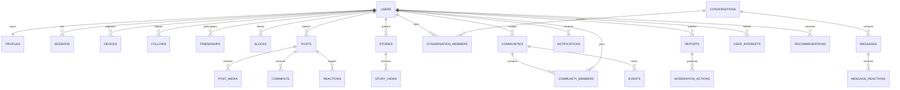

# Hiyall database design

**Status:** Architecture draft — logical model, not executable migrations

**Primary source of truth:** Aurora PostgreSQL for relational domains; DynamoDB for selected high-volume access patterns after measurement

**Identifiers:** server-generated UUIDv7 IDs (`uuid` representation in PostgreSQL); API examples with prefixes are illustrative legacy notation

**Timestamps:** UTC `timestamptz`; event/locale display retains an IANA time-zone ID where needed

## 1. Design rules

1. Every table has an explicit owner module. Cross-module code uses repositories/application queries, never direct table joins.
2. Foreign keys enforce referential integrity in the initial co-located PostgreSQL store, including agreed cross-module ID references; they do not grant direct query/write access to another module. Extraction replaces cross-store FKs with command validation and reconciliation. Restrict deletion to lifecycle jobs; do not cascade-delete an entire user graph in one transaction.
3. Soft deletion/tombstones are used where feeds, search, moderation, legal holds, or audit need to distinguish “removed” from “never existed.”
4. Search, feed entries, recommendations, notification counts, and reaction counters are projections. They must be rebuildable.
5. High-volume tables start in PostgreSQL only when access patterns fit; moving to DynamoDB is a storage implementation change behind a module contract.
6. No table includes plaintext passwords, bearer tokens, refresh tokens, raw OTPs, or private AI/provider keys.
7. PII, operational IDs, analytics IDs, residency, retention class, consent, and legal holds are separate concerns and are not copied into every projection.
8. Each query pattern has a bounded page size and a cursor. Unbounded scans and offset pagination are not allowed in product paths.

## 2. Logical ER diagram

This diagram shows source-of-truth relationships; projections and event tables are intentionally omitted for clarity.

## 3. Common types and conventions

| Logical type | PostgreSQL | JSON/API | Notes |
|---|---|---|---|
| ID | `uuid` | opaque string | UUIDv7 internally; serialize canonical UUID strings in the typed MVP contract. IDs are not an access control and may reveal approximate creation time. |
| Instant | `timestamptz` | ISO-8601 UTC | server-generated for ordering/audit |
| Local zone | `text` | IANA ID | e.g. `Asia/Calcutta`; validate against tz database |
| Locale | `text` | BCP-47 | e.g. `en-GB`, `hi-IN` |
| Money | integer minor units + ISO currency | object | no floating-point money |
| Status | constrained `text`/enum | string | additive changes require compatibility review |
| Flexible metadata | `jsonb` | object | schema-versioned, bounded, no secrets |
| Hash | `bytea`/`text` | redacted string | one-way or keyed hash as appropriate |

## 4. Core identity and privacy tables

### 4.1 `users` — Identity module

**Purpose:** account lifecycle and stable user identity.

**Columns**

| Column | Type | Rules |
|---|---|---|
| `user_id` | `uuid` | PK |
| `home_region` | `text` | required; validated region code |
| `status` | `text` | `active`, `deactivated`, `suspended`, `banned`, `deleting`, `deleted` |
| `account_type` | `text` | `person`, `creator`, `organisation`, subject to policy |
| `age_band` | `text` | coarse policy field; do not expose as a discovery filter |
| `created_at` | `timestamptz` | required |
| `updated_at` | `timestamptz` | required |
| `deactivated_at` | `timestamptz` | nullable |
| `deleted_at` | `timestamptz` | nullable tombstone |
| `retention_until` | `timestamptz` | nullable legal/policy retention |
| `policy_version` | `text` | terms/privacy/age policy version |

**Foreign keys:** none. Authentication identities are in a separate `auth_identities` table owned by Identity.

**Indexes:** `(status, created_at DESC)`, `(home_region, user_id)`, partial index on active users if needed.

**Partitioning:** no partition below ~10M rows; hash by `user_id` or split by home-region ownership when sharding. Never partition by mutable status.

**Expected growth:** 100M+ rows; low write rate after creation, frequent point reads.

### 4.2 `profiles` — Profiles and privacy module

**Purpose:** user-facing profile and optional fields.

**Columns:** `user_id uuid PK/FK users.user_id`, `username citext NOT NULL`, `display_name text NOT NULL`, `bio text`, `avatar_media_id uuid`, `cover_media_id uuid`, `pronouns text`, `country_code text`, `region_code text`, `city_label text`, `timezone text`, `website_url text`, `profession text`, `education text`, `profile_visibility text`, `search_visibility text`, `created_at timestamptz`, `updated_at timestamptz`, `version bigint`.

**Foreign keys:** `user_id -> users.user_id`; media IDs reference Media metadata when that module is relational; cross-module checks are event-reconciled.

**Indexes:** unique `(username)` case-insensitive; `(display_name)` only for bounded prefix/search; `(country_code, region_code, city_label)` only for voluntarily discoverable profiles; `(updated_at DESC)` for cache invalidation.

**Partitioning:** none initially; regional user ownership at scale. Keep username uniqueness in an unpartitioned `username_registry`; PostgreSQL cannot preserve unique username alone on a user-ID-partitioned table. A shard migration must reserve a handle before writing its profile and reconcile reservation failures.

**Expected growth:** 100M rows, one current row per user; reads dominate.

### 4.3 `sessions` — Identity module

**Purpose:** refresh/session lifecycle and revocation metadata; never stores raw bearer secrets.

**Columns:** `session_id uuid PK`, `user_id uuid`, `device_id uuid nullable`, `current_refresh_generation bigint`, `created_at timestamptz`, `last_seen_at timestamptz`, `expires_at timestamptz`, `revoked_at timestamptz nullable`, `revoke_reason text nullable`, `ip_prefix inet nullable`, `user_agent_hash bytea nullable`, `risk_level text`.

**Foreign keys:** `user_id -> users.user_id`; `device_id -> devices.device_id` when present.

**Indexes:** `(user_id, revoked_at, expires_at)`,  `(expires_at)` for cleanup, `(device_id, revoked_at)`.

**Partitioning:** none initially; hash on `session_id` only after measurement. Token hashes and rotated-token history live in `session_refresh_tokens`; expiry cleanup uses an indexed, bounded worker. Time partitioning would require changing PK/FKs and is not the default.

**Expected growth:** approximately active devices/sessions, usually 1–10 per active user; high churn, bounded by expiry.

### 4.4 `devices` — Identity/Notifications module

**Purpose:** registered device metadata and push routing.

**Columns:** `device_id uuid PK`, `user_id uuid`, `installation_id uuid`, `platform text`, `app_version text`, `locale text`, `timezone text`, `push_token_encrypted bytea nullable`, `push_token_hash bytea nullable`, `push_provider text nullable`, `last_seen_at timestamptz`, `created_at timestamptz`, `revoked_at timestamptz nullable`, `capabilities jsonb`.

**Foreign keys:** `user_id -> users.user_id`.

**Indexes:** `(user_id, revoked_at, last_seen_at DESC)`, unique provider token hash where supported, `(platform, app_version)` for rollout analysis.

**Partitioning:** none initially; future hash by `device_id` preserves its PK. A user-centric device projection supports listing; provider token uniqueness moves to a dedicated registry if needed. Clean revoked devices asynchronously.

**Expected growth:** 100M users × multiple devices; push-token churn can exceed user creation rate.

## 5. Social graph tables

### 5.1 `friendships` — Social graph module

**Purpose:** mutual friend request and accepted friendship state.

**Columns:** `friendship_id uuid PK`, `user_low_id uuid`, `user_high_id uuid`, `requested_by uuid`, `status text` (`pending`, `accepted`, `declined`, `cancelled`, `removed`), `created_at timestamptz`, `responded_at timestamptz nullable`, `updated_at timestamptz`.

`user_low_id` and `user_high_id` store the sorted pair so a friendship has one canonical row.

**Foreign keys:** all user IDs -> `users.user_id`.

**Indexes:** unique `(user_low_id, user_high_id)`, `(user_low_id, status, updated_at DESC)`, `(user_high_id, status, updated_at DESC)`, `(requested_by, status, created_at DESC)`.

**Partitioning:** no partition initially; future pair-hash storage requires PK `(user_low_id,user_high_id)` plus a friendship-ID directory, replacing the current UUID PK through an explicit migration. Maintain adjacency read models if mutual-friend queries outgrow SQL.

**Expected growth:** up to O(users × average friends); potentially billions of rows in a mature global network.

### 5.2 `follows` — Social graph module

**Purpose:** directed following relationship.

**Columns:** `follower_id uuid`, `followee_id uuid`, `state text` (`pending`, `active`, `removed`), `created_at timestamptz`, `removed_at timestamptz nullable`, `source text`.

**Primary key:** `(follower_id, followee_id)`.

**Foreign keys:** both IDs -> `users.user_id`.

**Indexes:** `(follower_id, state, created_at DESC)`, `(followee_id, state, created_at DESC)`, optional `(followee_id, created_at DESC)` covering index for follower counts.

**Partitioning:** hash by follower for following reads and a reverse adjacency projection by followee; at very large scale use DynamoDB adjacency records with both access paths.

**Expected growth:** potentially tens of billions of edges; this is a primary scale boundary.

### 5.3 `blocks` — Social graph/privacy module

**Purpose:** authoritative block decisions.

**Columns:** `blocker_id uuid`, `blocked_id uuid`, `created_at timestamptz`, `removed_at timestamptz nullable`, `reason text nullable`.

**Primary key:** `(blocker_id, blocked_id)`.

**Foreign keys:** both IDs -> `users.user_id`.

**Indexes:** `(blocker_id, removed_at)`, `(blocked_id, removed_at)`, unique active pair constraint.

**Partitioning:** hash by `blocker_id`; replicate/cache only with short TTL and invalidation. Blocks must be checked synchronously for protected actions.

**Expected growth:** sparse relative to follows; high correctness and low-latency requirements.

## 6. Content and feed tables

### 6.1 `posts` — Content module

**Purpose:** canonical user/community/Moment posts.

**Columns:** `post_id uuid PK`, `author_id uuid`, `owner_type text`, `owner_id uuid nullable`, `post_type text`, `body text nullable`, `visibility text`, `status text`, `language_code text nullable`, `location_label text nullable`, `created_at timestamptz`, `edited_at timestamptz nullable`, `deleted_at timestamptz nullable`, `moderation_state text`, `reply_policy text`, `version bigint`, `metadata jsonb`.

**Foreign keys:** `author_id -> users.user_id`; owner IDs are module-polymorphic and validated by the owning module/application service.

**Indexes:** `(author_id, created_at DESC)`, `(owner_type, owner_id, created_at DESC)`, `(status, created_at DESC)`, `(visibility, created_at DESC)` only where useful, partial `(author_id, created_at DESC, post_id) WHERE deleted_at IS NULL`, moderation queue `(moderation_state, created_at)`.

**Partitioning:** none initially; hash by `post_id` within a regional cell if necessary, preserving the PK and child references. Date partitioning is a separate migration requiring `(created_at,post_id)` keys on all referencing children or an ID directory. Do not ship a date-partitioned table with `PRIMARY KEY(post_id)`.

**Expected growth:** billions over product lifetime; write-heavy and read through feed/search projections.

### 6.2 `post_media` — Content/Media module

**Purpose:** ordered association of media assets with a post.

**Columns:** `post_id uuid`, `media_id uuid`, `position smallint`, `alt_text text nullable`, `created_at timestamptz`.

**Primary key:** `(post_id, position)`; unique `(post_id, media_id)`.

**Foreign keys:** `post_id -> posts.post_id`; `media_id` references Media metadata through a validated command/event boundary.

**Indexes:** `(media_id)`, `(post_id, position)`.

**Partitioning:** hash by post ID at scale, preserving both uniqueness constraints; object bytes never live in the database.

**Expected growth:** 1–10 rows per media post; can reach billions of associations.

### 6.3 `comments` — Content module

**Purpose:** post comments and nested replies.

**Columns:** `comment_id uuid PK`, `post_id uuid`, `author_id uuid`, `parent_comment_id uuid nullable`, `body text`, `status text`, `created_at timestamptz`, `edited_at timestamptz nullable`, `deleted_at timestamptz nullable`, `moderation_state text`, `version bigint`.

**Foreign keys:** `post_id -> posts.post_id`, `author_id -> users.user_id`, `parent_comment_id -> comments.comment_id` within the same post.

**Indexes:** `(post_id, created_at DESC, comment_id)`, `(parent_comment_id, created_at ASC)`, `(author_id, created_at DESC)`, moderation `(moderation_state, created_at)`.

**Partitioning:** none initially. Future hash by `post_id` requires PK `(post_id,comment_id)` and composite parent FK `(post_id,parent_comment_id)`; comment-ID addressing uses a directory. Sharding distributes distinct posts, not one hot thread. Cap depth, read size, and per-target write rates.

**Expected growth:** several comments per post on average, but highly skewed hot posts; potentially billions.

### 6.4 `reactions` — Content module

**Purpose:** typed reactions on posts/comments/stories/Moments.

**Columns:** `reaction_id uuid PK`, `target_type text`, `target_id uuid`, `user_id uuid`, `reaction_type text`, `created_at timestamptz`, `removed_at timestamptz nullable`.

**Foreign keys:** `user_id -> users.user_id`; target integrity is enforced by module commands or a target-specific split table if polymorphic checks become unsafe.

**Indexes:** unique active `(target_type, target_id, user_id)`, `(target_type, target_id, created_at DESC)`, `(user_id, created_at DESC)`.

**Partitioning:** none initially; target-hash partitioning requires composite PK `(target_type,target_id,reaction_id)`, while the active-target uniqueness already includes partition columns. Counters update asynchronously; do not count in request paths.

**Expected growth:** high fanout and high write rate; potentially billions. If one target type dominates, split it into a dedicated table.

## 7. Stories and chat tables

### 7.1 `stories` — Stories module

**Purpose:** expiring photo/video/text/music story entries.

**Columns:** `story_id uuid PK`, `author_id uuid`, `story_type text`, `body text nullable`, `media_id uuid nullable`, `audience_type text`, `audience_ref uuid nullable`, `created_at timestamptz`, `published_at timestamptz nullable`, `expires_at timestamptz nullable until published`, `deleted_at timestamptz nullable`, `moderation_state text`, `metadata jsonb`.

**Foreign keys:** `author_id -> users.user_id`; media/audience references are validated by module contracts.

**Indexes:** `(author_id, expires_at DESC)`, `(expires_at, story_id)` for expiry workers, `(audience_type, audience_ref, created_at DESC)`, moderation queue.

**Partitioning:** none initially; hash by `story_id` preserves PK and view FK. Expiry uses indexed cleanup plus read-time enforcement; do not range-partition without migrating all story keys and references. Highlights copy an explicit authorized archival reference rather than extending expired-story access automatically.

**Expected growth:** high write/read burst, but bounded by expiry; views can be much larger than story rows.

### 7.2 `story_views` — Stories module

**Purpose:** idempotent viewer state and analytics-safe view record.

**Columns:** `story_id uuid`, `viewer_id uuid`, `first_viewed_at timestamptz`, `last_viewed_at timestamptz`, `view_count integer`, `completion_ratio numeric nullable`.

**Primary key:** `(story_id, viewer_id)`.

**Foreign keys:** `viewer_id -> users.user_id`; `story_id -> stories.story_id` where co-located.

**Indexes:** `(viewer_id, last_viewed_at DESC)`, `(story_id, last_viewed_at DESC)`.

**Partitioning:** hash by story ID and optional time-windowed retention; raw event stream is separate from the current idempotent view state.

**Expected growth:** potentially many viewers per story; high write volume and TTL/retention sensitivity.

### 7.3 `conversations` — Chat module

**Purpose:** 1:1, group, Moment, and event chat metadata.

**Columns:** `conversation_id uuid PK`, `conversation_type text`, `home_region text`, `created_by uuid`, `title text nullable`, `avatar_media_id uuid nullable`, `last_sequence bigint`, `version bigint`, `membership_epoch bigint`, `last_message_at timestamptz nullable`, `status text`, `disappearing_policy jsonb nullable`, `created_at timestamptz`, `archived_at timestamptz nullable`.

**Foreign keys:** `created_by -> users.user_id`; media and owner links are validated across modules.

**Indexes:** `(home_region, last_message_at DESC)`, `(created_by, created_at DESC)`, `(status, last_message_at DESC)`.

**Partitioning:** no partition for metadata initially; hash by `conversation_id` and assign durable home-region ownership at scale.

**Expected growth:** roughly number of chats/Moments/events; millions to billions depending on product behavior.

### 7.4 `conversation_members` — Chat module

**Purpose:** membership, roles, per-user read/mute state, and message permissions.

**Columns:** `conversation_id uuid`, `user_id uuid`, `role text`, `membership_state text`, `joined_at timestamptz`, `left_at timestamptz nullable`, `last_read_sequence bigint`, `last_delivered_sequence bigint`, `muted_until timestamptz nullable`, `notification_mode text`, `permissions jsonb`, `updated_at timestamptz`.

**Primary key:** `(conversation_id, user_id)`.

**Foreign keys:** `conversation_id -> conversations.conversation_id`, `user_id -> users.user_id`.

**Indexes:** `(user_id, membership_state, updated_at DESC)`, `(conversation_id, membership_state, joined_at)`, `(conversation_id, last_read_sequence)`.

**Partitioning:** hash by conversation ID for member lists; maintain a user-centric inbox projection for chat list reads. Large communities require a separate membership strategy from small group chat.

**Expected growth:** edges can exceed users by orders of magnitude; large communities create hot partitions.

### 7.5 `messages` — Chat module

**Purpose:** logical durable message record. Storage begins relational where feasible and moves to DynamoDB/Scylla-like access-pattern storage for high-volume conversations.

**Logical columns:** `conversation_id uuid`, `sequence bigint`, `message_id uuid`, `sender_id uuid`, `client_message_id uuid`, `message_type text` (encrypted relay/tombstone only), `protocol_version text`, `envelope_ref uuid`, `version bigint`, `created_at timestamptz`, `edited_at timestamptz nullable`, `deleted_at timestamptz nullable`, `moderation_state text`, `expires_at timestamptz nullable`, `metadata jsonb`.

**Primary key:** `(conversation_id, sequence)` for ordered reads; unique `(conversation_id, sender_id, client_message_id)` for durable retry deduplication and unique `(conversation_id,message_id)` for addressing. A member cannot collide with another sender’s client ID. Public message access is always conversation-scoped.

**Foreign keys:** `sender_id -> users.user_id`, `conversation_id -> conversations.conversation_id`; sender/conversation authorization remains server-side. Decrypted reply targets, reactions and body type are client-validated inside authenticated ciphertext; do not expose reply text/language/body metadata for server indexing.

**Indexes:** `(conversation_id, sequence DESC)`, `(sender_id, created_at DESC)`, unique idempotency key, moderation/expiry work queues. No plaintext private-message body exists to index.

**Partitioning:** none initially, then hash by `conversation_id`, included in every unique key. At DynamoDB cutover use conversation + bounded bucket as partition key, sequence as sort key, separate durable sender/client-ID dedupe records, and same-region transaction/ordered owner; see §15. Time partitioning without adapting the retry key would allow duplicates across partitions. Hot conversation limits and large-group fanout are explicit capacity constraints.

**Expected growth:** billions; highest-risk transactional data path. Durable acknowledgement must not depend on push delivery.

### 7.6 `message_reactions` — Chat module

**Purpose:** client-local decrypted reaction projection. This former server-source table is superseded by encrypted control envelopes; the server must not store clear reaction types for E2EE chats.

**Columns:** `conversation_id uuid`, `message_sequence bigint`, `message_id uuid`, `user_id uuid`, `reaction_type text`, `created_at timestamptz`, `removed_at timestamptz nullable`.

**Primary key:** `(conversation_id, message_sequence, user_id)`; `reaction_type` is an updatable value, not part of identity.

**Foreign keys:** `user_id -> users.user_id`; `(conversation_id,message_sequence)` -> messages; optional stored `message_id` must agree with that row, never supply a second independent target.

**Indexes:** `(conversation_id, message_sequence, created_at DESC)`, `(user_id, created_at DESC)`.

**Partitioning:** co-partition with messages by conversation; counters are asynchronous projections.

**Expected growth:** high in active chats; bounded local cache. Durable server representation is an encrypted message/control event, not a plaintext reaction row.

## 8. Notifications, community, and event tables

### 8.1 `notifications` — Notifications module

**Purpose:** in-app notification items; push delivery attempts are separate operational records.

**Columns:** `notification_id uuid PK`, `recipient_id uuid`, `type text`, `actor_id uuid nullable`, `object_type text nullable`, `object_id uuid nullable`, `group_key text nullable`, `payload jsonb`, `read_at timestamptz nullable`, `created_at timestamptz`, `expires_at timestamptz nullable`, `dedupe_key text nullable`.

**Foreign keys:** `recipient_id -> users.user_id`; actor if present -> users; object is polymorphic and visibility-checked at read/deep-link time.

**Indexes:** `(recipient_id, created_at DESC, notification_id)`, `(recipient_id, read_at, created_at DESC)`, unique `(recipient_id, dedupe_key)` where active, `(expires_at)` cleanup.

**Partitioning:** none initially; hash by `recipient_id` at scale requires PK `(recipient_id,notification_id)`, included in every addressing command; at very high volume use DynamoDB `PK=USER#id`, `SK=NOTIFICATION#time#id`.

**Expected growth:** high churn and fanout; retain according to user-facing history policy, not forever.

### 8.2 `communities` — Community module

**Purpose:** durable interest/community space.

**Columns:** `community_id uuid PK`, `owner_id uuid`, `name text`, `slug citext`, `description text`, `avatar_media_id uuid nullable`, `privacy text`, `status text`, `rules jsonb`, `created_at timestamptz`, `updated_at timestamptz`, `moderation_state text`.

**Foreign keys:** `owner_id -> users.user_id`; media reference validated by Media.

**Indexes:** unique `(slug)`, `(privacy, status, created_at DESC)`, `(owner_id, created_at DESC)`, search projection key.

**Partitioning:** none initially; hash by ID or regional ownership at high count. Public search is projection-driven.

**Expected growth:** millions of communities; reads/search dominate after creation.

### 8.3 `community_members` — Community module

**Purpose:** membership, role, approval, and moderation state.

**Columns:** `community_id uuid`, `user_id uuid`, `role text`, `membership_state text`, `joined_at timestamptz`, `approved_by uuid nullable`, `approved_at timestamptz nullable`, `notification_mode text`, `last_seen_content_at timestamptz nullable`.

**Primary key:** `(community_id, user_id)`.

**Foreign keys:** `community_id -> communities.community_id`, `user_id -> users.user_id`, `approved_by -> users.user_id`.

**Indexes:** `(user_id, membership_state, joined_at DESC)`, `(community_id, membership_state, joined_at DESC)`, `(community_id, role)`.

**Partitioning:** hash by community ID for member lists; very large communities need sharded membership reads and bounded admin queries.

**Expected growth:** potentially billions of membership edges; one of the graph/fanout scale boundaries.

### 8.4 `events` — Events module

**Purpose:** global time-zone-aware events owned by users or communities.

**Columns:** `event_id uuid PK`, `owner_type text`, `owner_id uuid`, `created_by uuid`, `title text`, `description text`, `starts_at timestamptz`, `ends_at timestamptz`, `organizer_timezone text`, `location_type text`, `location_label text nullable`, `online_url_ref text nullable`, `visibility text`, `status text`, `created_at timestamptz`, `updated_at timestamptz`.

**Foreign keys:** `created_by -> users.user_id`; owner is validated by Community/User module.

**Indexes:** `(owner_type, owner_id, starts_at)`, `(visibility, status, starts_at)`, `(organizer_timezone, starts_at)` only for bounded operational queries.

**Partitioning:** none initially; hash by `event_id` preserves PK and RSVP references. Rescheduling makes starts_at a poor physical ownership key. Archive past events under retention policy.

**Expected growth:** lower than posts/messages but can be globally bursty; RSVP and reminder projections are separate.

## 9. Trust, safety, interests, and recommendations

### 9.1 `reports` — Trust and Safety module

**Purpose:** user-submitted reports and case intake.

**Columns:** `report_id uuid PK`, `reporter_id uuid`, `target_type text`, `target_id uuid`, `reason_code text`, `description text nullable`, `severity text`, `status text`, `region text`, `created_at timestamptz`, `resolved_at timestamptz nullable`, `resolution_code text nullable`, `evidence_ref jsonb nullable`.

**Foreign keys:** `reporter_id -> users.user_id`; target is polymorphic and captured by immutable evidence references where policy allows.

**Indexes:** `(status, severity, created_at)`, `(target_type, target_id, created_at DESC)`, `(reporter_id, created_at DESC)`, `(region, status, created_at)`.

**Partitioning:** none initially. Future hash by `report_id` preserves its PK/action references. A time-range migration needs composite report/action references. Preserve audit/legal holds before purge.

**Expected growth:** reports are lower volume than content but operationally sensitive; case history can be long-lived.

### 9.2 `moderation_actions` — Trust and Safety module

**Purpose:** immutable-ish audit of moderator/system actions.

**Columns:** `action_id uuid PK`, `report_id uuid nullable`, `actor_type text`, `actor_id uuid nullable`, `target_type text`, `target_id uuid`, `action_type text`, `reason_code text`, `policy_version text`, `metadata jsonb`, `created_at timestamptz`, `expires_at timestamptz nullable`.

**Foreign keys:** `report_id -> reports.report_id` when present; actor may be system or moderator; target polymorphic.

**Indexes:** `(target_type, target_id, created_at DESC)`, `(report_id, created_at)`, `(actor_id, created_at DESC)`, `(action_type, created_at DESC)`.

**Partitioning:** none initially; time-range scale design uses PK `(created_at,action_id)` and an action-ID directory for appeals. Append-only retention with legal/audit policy.

**Expected growth:** one or more actions per case/content item; must remain auditable.

### 9.3 `user_interests` — Profiles/Recommendations module

**Purpose:** explicit Interest Passport selections and visibility.

**Columns:** `user_id uuid`, `interest_id uuid`, `source text` (`user_selected`, `imported`, `inferred`), `visibility text`, `weight smallint nullable`, `created_at timestamptz`, `updated_at timestamptz`.

**Primary key:** `(user_id, interest_id)`.

**Foreign keys:** `user_id -> users.user_id`; `interest_id` references a versioned taxonomy table owned by Recommendations/Content.

**Indexes:** `(user_id, visibility)`, `(interest_id, visibility, user_id)`, `(source, updated_at)`.

**Partitioning:** hash by user ID; taxonomy/interest counts are projections.

**Expected growth:** users × tens/hundreds of interests; relatively small compared with graph/content.

### 9.4 `recommendations` — Recommendations module/projection

**Purpose:** explainable, expiring recommendations for a viewer.

**Columns:** `viewer_id uuid`, `recommendation_type text`, `candidate_id uuid`, `rank_score numeric`, `reason_codes jsonb`, `model_version text`, `policy_version text`, `generated_at timestamptz`, `expires_at timestamptz`, `dismissed_at timestamptz nullable`.

**Primary key:** `(viewer_id, recommendation_type, candidate_id, generated_at)` in relational form; DynamoDB alternative `PK=USER#viewer`, `SK=REC#type#rank#candidate`.

**Foreign keys:** viewer -> users; candidates are type-specific and validated on read. Do not copy private graph edges or sensitive attributes into the API payload.

**Indexes:** `(viewer_id, recommendation_type, expires_at, rank_score DESC)`, `(candidate_id, generated_at DESC)` for debugging only.

**Partitioning:** hash by viewer ID and TTL by `expires_at`; always rebuildable from source events/features.

**Expected growth:** roughly active users × recommendation slots × refresh frequency; high churn, not canonical data.

## 10. Required supporting entities

These are not all in the requested list but are required for a production implementation:

| Entity | Purpose | Store/partition notes |
|---|---|---|
| `auth_identities` | OIDC provider subject, email/phone ownership, passkey credential metadata | Unique `(provider, subject)`; encrypt or minimise verified contact values |
| `privacy_settings` | field/surface-specific discovery, messaging, story, mention, activity, location controls | One current row per user plus version; strong consistency |
| `media_assets` | upload session, quarantine/published state, MIME, checksum, variants, moderation | Relational metadata; bytes in S3; status transitions audited |
| `message_attachments` | ordered message-to-media links | Co-partition with messages; no binary payload in DB |
| `message_receipts` | optional per-recipient delivery/read watermarks | Prefer conversation/member watermarks; avoid one row per recipient/message at scale |
| ~~`outbox_events`~~ (removed, migration 0038: nothing consumed it) | transactionally staged events | Range partition by `occurred_at`; retry/DLQ metadata and idempotent publish |
| `idempotency_records` | retried command result/deduplication | Scope + key unique; TTL/expiry partition; do not store sensitive bodies unnecessarily |
| `feed_items` | per-viewer candidate/materialization | Rebuildable; DynamoDB or partitioned Postgres with TTL/score cursor |
| `notification_preferences` | per-type, quiet hours, digest, device settings | Cacheable with version/invalidation |
| `audit_log` | security/admin/privacy access and changes | Append-only, WORM/central log retention where required |
| `analytics_events` | versioned product event envelope | Kinesis/S3 partitioned by date/region; not transactional tables |

## 11. Query/access-pattern catalog

The following queries must have bounded plans and be represented in repository tests:

| Access pattern | Authoritative store | Required key/index |
|---|---|---|
| Resolve login identity | Identity DB | `(provider, subject)` unique |
| Load profile by user/handle | Profiles | PK `user_id`, unique handle |
| List following/followers | Graph | user adjacency + cursor on created/ID |
| Check block before action | Graph/privacy | pair lookup, short-lived cache with invalidation |
| Load Pulse page | Feed projection + content | viewer partition + opaque cursor |
| Load stories tray | Stories projection/source | author/audience + expiry |
| Read comments | Content | post + created/comment cursor |
| Read chat history | Messages | conversation + descending sequence |
| Send message retry | Chat | conversation + client message ID conditional write |
| Chat list | Chat inbox projection | user + last activity |
| Search public users | Search projection | prefix/full-text + visibility filter |
| Recommendations | Recommendation projection | viewer + type + expiry/rank |
| Notification inbox | Notification store | recipient + created cursor |
| Moderation queue | Reports | status/severity/created cursor |

## 12. Migration and data lifecycle

- Use expand/contract migrations: add nullable/backward-compatible fields, deploy readers/writers, backfill, switch reads, remove old fields later.
- Never rely on application startup to run unbounded migrations.
- Use online index creation and lock/statement timeouts.
- Backfill projections from source tables or replayable events with progress checkpoints.
- Deletion workflows create durable jobs and verify completion per store; caches and projections are not treated as evidence of deletion until invalidated/rebuilt.
- Retention, legal holds, regional residency, and analytics/model erasure are explicit policy inputs.
- Restores must preserve encryption context, audit continuity, and version compatibility.

### Roles, grants and contention (as built)

- **Roles.** `hiyall_migrate` owns the schema, `hiyall_api` serves members, `hiyall_admin` runs the console. `database/roles/roles.sql` creates them once (superuser); `database/roles/grants.sql` is the privilege refresh that the table owner runs after every migration (`/migrate` with `MIGRATE_RUN_GRANTS=true`). It is one transaction (no window without rights) and asserts its result. `hiyall_api` has full DML on every table, SELECT on every view, and nothing on the operator tables; on `content_cases` it has INSERT and SELECT of `media_id` only (the media tombstone purge asks whether a case still points at a photo). Tests run the requests, every maintenance job and the account purge on `hiyall_api` (`internal/httpapi/restricted_role_test.go`, `cmd/api/dbrole_test.go`); a production start refuses an over-privileged role, **refuses a role whose grants are incomplete** (it names what is missing, table, column, sequence or function, and says to run `grants.sql` or set `MIGRATE_RUN_GRANTS=true`; a development start warns), `/readyz` repeats that check (cached 60 s; red once the gap has lasted a full interval, so the moments between a release's migrations and its `grants.sql` do not drop nodes), and `api check-config -db` compares the grants of `hiyall_api` and, when the cluster has it, `hiyall_admin`. The console (`admin serve`) makes the same check for `hiyall_admin` at start (production refuses, development warns; any other role, such as the shared `DATABASE_URL` role or an owner, is not judged there). The safety gauges (`hiyall_pending_approvals` and the three others) report `NaN`, never a stale or zero value, while `safety_queue_stats` cannot be read.
- **One list of special tables.** The tables `grants.sql` keeps from `hiyall_api` (the operator tables and `evidence_approvals`, the `content_cases` rules, the two operator sequences) are listed in the script and once in Go (`store.OperatorTables`, `store.SpecialTables()`, `store.OperatorSequences` in `store/roles.go`); `TestSpecialTablesMatchGrantsScript` parses the script and fails on any difference.
- **One list of explicit grants (round-4 audit N1).** `GrantProblems` used to check EXECUTE on two functions, so a missing grant on any other definer function was a 500 on first use behind a green `/readyz`. Every explicit `GRANT` of `grants.sql` for `hiyall_api` and `hiyall_admin` (table, column, sequence and EXECUTE on each function, with its argument types) is listed once in Go (`store.ExpectedGrants`, `store/roles.go`); `GrantProblems(role)` checks each with `has_table_privilege`, `has_column_privilege`, `has_sequence_privilege` or `has_function_privilege` (for `hiyall_api` on top of the blanket check of every table, view and sequence; for `hiyall_admin` the list only). `TestGrantSpecsMatchGrantsScript` parses the script and fails when the script grants something the list lacks or the list demands something the script does not grant; `TestGrantProblemsSeesEveryMissingExplicitGrant` takes each privilege away from its role in turn, on a database of its own, and requires exactly that one to be reported. A function added to a migration and to `grants.sql` is therefore checked from the day it is added, and the owner-path test (next item) must call it.
- **The owner path is tested without a superuser.** `TestOwnerPathWithoutSuperuser` (`cmd/migrate/owner_test.go`, also a required step of the Foundation workflow) builds a scratch database as the deploy guide does: `roles.sql` as the administrator, then the migrations and `grants.sql` as the non-superuser `hiyall_migrate`, then calls `prune_operator_audit`, `users_status_counters`, `revoke_session_devices`, `held_objects_due` and `mark_hold_purged` as the console and API roles that use them, and (`cmd/migrate/owner_safety_test.go`, round-4 audit N9) every other function `grants.sql` grants (`evidence_propose`, `evidence_decide`, `operator_promotion_propose`, `operator_set_role`, `operator_create`, `operator_set_disabled`, `content_case_confirm`, `content_case_report`, `evidence_expire_due`, `pending_cases_due`, `drop_pending_case`, `activate_quarantine_case`, `hold_still_releasable`, `hold_lock_for_purge`, `admin_schedule_deletion`, `apple_revocation_acknowledge`, `apple_revocations_prune`, `safety_queue_stats`) once as the owner and once as the role it is granted to, through a real scenario (propose, approve, promote, create, disable, drop, activate, lock, purge, delete, acknowledge). The test fails when `store.ExpectedGrants` names a function the scenario does not call. Every other test migrates as a superuser, which hides a SECURITY DEFINER function that needs more than ownership.
- **Contention.** A lock timeout (55P03), statement timeout or cancel (57014), deadlock (40P01) or serialization failure (40001) is answered 503 `TEMPORARILY_UNAVAILABLE` with `Retry-After: 1` and counted in `hiyall_db_contention_total{code}`. The store's transaction helper runs a transaction once more after a 40P01 or 55P03 (the work in it must be repeatable).
- **Counters.** `social_counters` follow the follow, friendship and user-status triggers (migration 0033). Paths that end an edge lock both members first (`lockMembers`); the weekly reconcile locks the chunk's counter rows in id order before it recounts (`ReconcileSocialCounters`); the account purge's batch delete of follows and friendships locks the other members' user rows and then every counter row it touches once, in id order, before the per-row triggers fire; the order is guaranteed by data dependency between the statement's CTEs (the delete reads `locked`, which reads `people`), not by the order the executor starts them. `TestSocialCountersEqualARecountAfterConcurrentChanges` runs it all concurrently and compares with a recount.
- **Indexes added for purges and cascades (migration 0039):** `message_envelopes(recipient_device_id)`, `space_entries(space_id)`, `friendships(user_high_id)`, and the partial `sessions(user_id) WHERE revoked_at IS NULL`.
- **Indexes added in migration 0044 (round-3 audit):** `devices(user_id)` and `conversation_members(peer_id)` (full indexes for the purge and the foreign key checks; the purge's `DELETE ... WHERE user_id=$1 OR peer_id=$1` was a sequential scan, 9.5 ms at 200k rows and growing with the table, now two bitmap index scans at 0.13 ms), `reports(target_id)` and the partial `reports(report_id) WHERE evidence IS NOT NULL`, `messages(created_at, message_id)` (replaces `messages_age`), `media_assets(deleted_at, media_id)` for deleted photos with objects (replaces `media_deleted`), `friendships(user_high_id, user_low_id)` (replaces `friendships_high`) and `operator_audit(at)`.
- **Retention walks are keyset walks.** `PurgeMessageMetadata` reads old messages in `(created_at, message_id)` order from a cursor, 1000 examined per statement; each member's kept latest message and every reported or attachment-bearing message is looked at once per pass and not once per chunk (before, every chunk began again at the oldest row and re-evaluated all of them). The cursor is kept in `reconcile_state` (job `message_metadata_purge`, `"<created_at>|<message_id>"`) after every window (round-4 audit N5), so a run cut short by the job's time limit, a crash or a deploy is continued by the next run, and a run that reached the end leaves the cursor at the last row it examined: the following runs look only at messages that have aged in since, not at the kept rows again. `MessageMetadataRewalk` (24 hours) after a pass reached its end the next run starts again from the oldest message, which is when a row that was kept and is no longer needed (the peer's newer message arrived, a report closed) is removed. `TestPurgeMessageMetadataResumesPastKeptRows` covers the second run examining 0 of 2205 old rows, a message that aged in being the only one examined, the new pass, and a crash after the second window. `PurgeMedia` reads expired uploads and deleted photos each in index order from a cursor, so a chunk of 50 costs 0.1 ms where the old single query sorted the whole backlog (250k rows, a 20 MB sort on disk, 108 ms) for every chunk.
- **Ids named by reports.** The account purge and the message retention job read the message ids in report evidence once per statement (the `reports_with_evidence` index, a hash set) and look a reported target up with `reports_target`; a per-message containment test scanned every report with evidence for every message (936 ms for one batch of 1000 with 1000 such reports, 28 ms with 5000 reports after the change).
- **`prune_operator_audit`** answers `0` before it asks for the table lock when no entry is older than the cutoff (one probe on `operator_audit(at)`: 0.35 ms against a 37 ms sequential scan at 300k rows); the `ALTER TABLE ... DISABLE TRIGGER` that needs an exclusive lock happens only when there is something to delete.
- **Counters of a very large account (migration 0044).** Suspending, restoring or deactivating an account used to rewrite every neighbour's counter row inside the status update: 0.7 s at 200,000 edges but 12.9 s at 1,000,000, past the 5 s statement timeout of the upload scanner's auto-suspend (which would then fail and leave the account active). `users_status_counters` now looks at no more than 20,001 edges. Up to 20,000 it does the delta in the trigger as before (exact at commit); above that it queues the account in `counter_fixups` and returns (a suspension of a 1,000,000 follower account: 1 to 2 ms). The maintenance job `counter fixups` (`Store.ApplyCounterFixups`, hourly, 20-minute budget) recounts the neighbours in chunks of 500, each its own transaction, walking each direction in the order of an existing index, from the follow and friendship rows (what the weekly reconcile writes), so counters converge. Trade-off: after the commit and until the job has passed, up to the next hourly run, neighbours of that one account still show its old status in their counts; and an edge removed from a neighbour the recount has not reached yet, while the account is not active, stays one too high until the weekly `ReconcileSocialCounters` (members cannot change a relationship with an account that is suspended, deactivated or in deletion). A status change while a recount is queued or running queues it again from the start instead of applying a delta the recount would count twice. `TestSuspendingAHighDegreeAccountIsBoundedAndCountersConverge` proves it.
- **Counter fix-up streams order by the typed columns (round-4 audit N3).** The four streams selected `created_at::text` and `follower_id::text` and then said `ORDER BY created_at DESC, follower_id DESC`; a bare name in ORDER BY means the OUTPUT column when one has that name, so they sorted the text, in the collation of the database. That is wrong twice: under a language collation (ICU `en-US`, glibc `en_US.UTF-8`) the text of a whole second sorts after its fractions, the reverse of the timestamps, so the chunk's cursor jumped past neighbours that had not been read and their counters were never recounted (the test skipped 1300 of 3401 neighbours); and the text sort cannot use the index, so every chunk sorted the account's whole neighbourhood. The ORDER BY now names the table's columns (`f.created_at`, `f.follower_id`) and the outputs are called `nb` and `ts`. EXPLAIN ANALYZE on 200,000 followers of one account, a chunk of 500 at the middle of the stream: 0.23 ms with an index-only scan on `follows_followee_list` and no sort, against 105.7 ms (a parallel sequential scan and a top-N sort of the 100,000 rows that remain) for the old statement. `PurgeMessageMetadata` picked the last row of its window the same way (`ORDER BY created_at DESC` over `created_at::text`) and could examine a window of kept rows for ever on an ICU database; it uses `l.created_at`, `l.message_id` now. `dbtest.ScratchICU` creates the language-collation database the tests need (`TestCounterFixupsVisitEveryNeighbourUnderALanguageCollation`, `TestCounterFixupStreamsAreIndexOrdered`, `TestPurgeMessageMetadataCursorIsTypedUnderALanguageCollation`); the default `Scratch` database uses the C collation, where the two orders agree and the bug cannot show.
- **The purge of an account finishes its queued recount first (round-4 audit N9).** The recount walks the account's follow and friendship rows; the account purge deletes them. A neighbour whose edge the purge deleted before the recount reached it was never visited and kept the counter that still counted the account (9000 of 20,200 followers one too high in `TestCounterFixupsAndAccountPurgeRaceWithFollows`, which runs the recount, the purge of a 20,500 edge account and 80,000 follows and unfollows together and requires no 40P01 after the retry and counters equal to a recount at the end). `purgeContent` calls `drainCounterFixups` before it deletes edges, and waits for its next run while another worker holds the queue row.
- **Retention of the Wave 4 tables.** `nearby_probe_centres` (keyed hashes only) is deleted after 3 days (`nearby probe purge`; `day < today - 3`); the account purge does not need it because it holds no account id. `evidence_approvals` is kept on purpose: it is the two-person record for clearing a case, releasing or lifting a hold, and goes with the audit trail (`operator_audit`, pruned only by an administrator after a year); it holds operator ids and reasons, never member content. The matching rows of `docs/legal/data-retention.md` are kept by the release and legal track.
- **Safety release 2 (migration 0043; round-3 audit API-1, 5, 6, 7, 8).** `apple_revocations` gains `status` (`queued`: a sealed token the purge retries; `manual`: no token, an operator revokes by hand; `token_sealed` is nullable only for `manual`), `user_id`, `reason` and `revocation_id`; a manual row is removed when the deletion is cancelled or an operator marks it done, and the console role reads every column but the token. `content_cases.status` gains `pending` (the case is written before the evidence objects; `activate_quarantine_case` opens it, the console sweep opens or drops stale ones). `evidence_approvals` also carries `promote_admin` proposals (`case_id` null, `target_operator` set). The two-person transitions, the support deletion and the queue counts are `SECURITY DEFINER` functions (`evidence_propose`, `evidence_decide`, `operator_promotion_propose`, `operator_set_role`, `content_case_confirm`, `content_case_report`, `evidence_expire_due`, `pending_cases_due`, `drop_pending_case`, `hold_still_releasable`, `admin_schedule_deletion`, `safety_queue_stats`, `activate_quarantine_case`; internal helpers `safety_fail`, `safety_admin_email`, `safety_counsel_ok`), executable by the roles named in `grants.sql` only; `hiyall_admin` has no `UPDATE` on `content_cases`, `evidence_approvals` or `operators.role`. `nearby_probe_centres` rows for a source address now hold the keyed hash of the ACCOUNT in the `centre` column (distinct accounts per address per day); the table itself is unchanged. No table is dropped and no column removed: the migration is an expand step.
- **Safety release 3 (migration 0046; round-4 audit API N-1 to N-12, DB N2, N8).** `content_cases`: `status` defaults to `pending`, `CHECK`s pin `original_key`/`full_key` to `hold/<media id>/original` and `.../full.jpg`, and a `BEFORE INSERT` trigger forces a plain pending case for `hiyall_api` (grants.sql gives that role `INSERT` on the scanner's columns only). `operators` are created and disabled by `operator_create` and `operator_set_disabled`; `hiyall_admin` lost `INSERT` on `operators` and `UPDATE` on `disabled_at`. The two-person functions, `operator_set_role`, `content_case_confirm`/`_report` and the new functions write their `operator_audit` row themselves (`safety_audit`, with `hiyall.ip`, `hiyall.reason`, `hiyall.actor` as transaction-local settings), and `evidence_decide` refuses a proposer who is no longer an active administrator (`PROPOSER_NOT_ADMIN`). `apple_revocations.status` gains `member_informed` (the app told the member to remove Hiyall in Apple ID settings; removed after 90 days by `apple_revocations_prune`); `manual` now means an operator has to tell the member; the console role has no `DELETE` (`apple_revocation_acknowledge`). `drop_pending_case` refuses a scanner `match`. `hold_lock_for_purge` takes `FOR SHARE` on the case row for the purge. `evidence_orphan_report` (one row) keeps the sweep's orphan list; `quarantine_upload_leftovers` records upload objects that could not be removed; `users.deletion_prior_status` records the status a support-driven deletion started from (a member who was suspended or banned cannot cancel it). `admin_schedule_deletion` takes an active administrator's e-mail address as the actor and audits under it.
- **Data release 3 (migration 0047; round-4 audit N4, N10).** `drop_pending_case` (the version of 0046 plus `deleted_at`) leaves the dropped upload at `status = 'deleted'` with a deletion time, so `PurgeMediaTombstones` and the media cleanup find it; before, such a row had `deleted_at NULL` and was never removed. The migration gives the rows already in that state `deleted_at = now()` (the day they were dropped is not recorded, so their 30 days start then). Owner, SECURITY DEFINER and ACL are unchanged. `sessions_revoked_tombstones` serves the walk below.
- **Revoked sign-in sessions (round-4 audit N10).** A revoked identity-provider session row is a tombstone: a Firebase session id (`fb:<subject>:<auth_time>`) is the same for every token the sign-in mints and refresh tokens do not expire by themselves, so "ID tokens live one hour" does not make an old tombstone useless. What makes one redundant is the identity's `sessions_revoked_before` watermark ("sign out everywhere else"): `resolveOIDCSlow` refuses a Firebase sign-in whose auth_time is not after the watermark and that has no session row. `PurgeRevokedSessionTombstones` (hourly job `revoked session tombstone purge`) deletes a row 400 days after the sign-out only when it is a Firebase session whose auth_time is at or before its identity's watermark. A tombstone of a single-device sign-out that no watermark covers, and any row of another provider, stays: deleting it would let that device sign in again. The walk keeps a cursor in `reconcile_state` (job `revoked_session_tombstones`, revocation order, restarted a day after a pass ended because a watermark may have advanced). `TestRevokedSessionTombstonesGoOnlyWhenTheWatermarkCoversThem` checks the covered, uncovered, young, no-watermark and foreign cases, that a purged tombstone's sign-in is still refused by `ResolveOIDC`, and the cursor.
- **Locking indexes are linted (round-4 audit N7).** A migration runs in one transaction on every deploy, and `CREATE INDEX` or `DROP INDEX` on a table with real data blocks its writes for the length of the build. From migration 0045 on, `TestNewMigrationsDoNotLockLargeTables` (`cmd/migrate/lint_test.go`) fails a migration that creates or drops an index on `messages`, `message_envelopes`, `media_assets`, `follows`, `notifications`, `chat_blobs`, `posts` or `comments` unless the statement is `CONCURRENTLY` in a file whose first line is `-- hiyall:no-transaction` (the runner then executes its statements one at a time outside a transaction; write such a file so that it can run twice). A file that really means to lock (a table that is still empty, a maintenance window) carries a line `-- hiyall:allow-locking-index` with the reason, which the reviewer reads. A `DROP INDEX` of an index no migration created fails too (the lint cannot know its table) unless it carries the allow line. `TestLintMigrationRules` pins the rules. Migrations before 0045 are applied and checksummed and are not judged.
- **Error classes.** A lock timeout, statement timeout, deadlock or dropped connection while a profile, privacy, onboarding, post or admin media lookup reads the account row is returned as that error (503 through the central mapping), not as "no such account" (404).

## 13. Database risks and thresholds

1. `follows`, `community_members`, and `friendships` can outgrow ordinary relational adjacency queries; establish edge-volume and hot-key thresholds before introducing a graph store.
2. `messages`, `story_views`, and `reactions` can create write hotspots; use conditional writes, hash partitioning, aggregates, and product caps.
3. `posts` and `comments` require query plans for hot authors/posts and partition maintenance; never assume an index alone solves skew.
4. Polymorphic target IDs improve a shared API but weaken foreign-key enforcement; split hot/critical targets if integrity incidents appear.
5. Feed and recommendation data must be disposable; do not accidentally make a projection the only copy of a user-visible fact.
6. Data residency may require separate clusters or regional table ownership earlier than raw scale would require.

## 14. Implementation constraints and supporting schemas

The preceding entities include all 25 requested core tables. The first migration must also include these supporting tables. This is a logical design, not an executable migration. Columns below are required unless marked `?`; PK and unique imply NOT NULL, all constrained text values are enforced with CHECK or reference tables. Descriptive optional text fields above are nullable. Every mutation timestamp and policy-bearing field is NOT NULL. JSON objects are schema-validated and size-capped; never use JSON to accept arbitrary authorization rules.

| Table / owner | Columns and keys | Access / indexes | Partition / growth |
|---|---|---|---|
| `auth_identities` / identity | `identity_id uuid PK, user_id uuid FK users, provider text, subject text, contact_ciphertext bytea?, lookup_hmac bytea?, verified_at timestamptz?, created_at timestamptz`; unique `(provider,subject)` and verified contact lookup where applicable | Login point lookup; user identity list `(user_id,identity_id)` | Unpartitioned MVP; global provider-subject registry per allowed jurisdiction at scale; 1–5 identities/user |
| `session_refresh_tokens` / identity | `token_hash bytea PK, session_id uuid FK sessions, generation bigint, state text(active/used/revoked), issued_at timestamptz, used_at timestamptz?, expires_at timestamptz, replaced_by_hash bytea?`; unique `(session_id,generation)` | Token lookup; family revoke `(session_id,state)`; expiry index | Unpartitioned first; hash by session requires composite token index/directory. Retain used token hashes until family maximum lifetime to detect reuse; high churn |
| `username_registry` / profiles | `username citext PK, user_id uuid FK users UNIQUE, reserved_at timestamptz, released_at timestamptz?` | Handle lookup/reserve; normalized ASCII handle separate from Unicode display name | Unpartitioned registry until explicit distributed uniqueness design; one/user |
| `privacy_settings` / profiles | `user_id uuid PK/FK users, profile_audience text, messages_from text, follow_policy text, requests_from text, story_audience text, activity_audience text, online_audience text, last_seen_audience text, location_audience text, comments_from text, mentions_from text, discoverable bool, show_interest_overlap bool, read_receipts bool, field_audiences jsonb, version bigint, updated_at timestamptz` | PK authorization reads; version increments in mutation transaction | Hash by user when needed; 100M rows |
| `notification_preferences` / notifications | `user_id uuid PK/FK users, enabled_types text[], quiet_start time?, quiet_end time?, quiet_timezone text?, digest_mode text, preview_mode text, version bigint, updated_at timestamptz` | PK lookup; cache version; quiet-time DST rules in mobile doc | Hash by user; one/user |
| `media_assets` / media | `media_id uuid PK, owner_id uuid FK users, purpose text, encryption_mode text(none/e2ee), status text, upload_id uuid UNIQUE, size_bytes bigint, mime_type text, checksum_sha256 text, quarantine_key text, published_key text?, variants jsonb, expires_at timestamptz, created_at timestamptz, deleted_at timestamptz?` | Owner+created, status+created, expires cleanup; owner must agree with upload session | Hash by media ID if needed; ~uploads, bytes in S3 |
| `message_attachments` / chat | `conversation_id uuid, sequence bigint, position smallint, media_id uuid, alt_text text?`; PK `(conversation_id,sequence,position)`; composite FK messages | Media ownership/ready check at attach; reverse `(media_id)` for erasure | Hash conversation; ≤10/message; high growth |
| `direct_conversation_pairs` / chat | `user_low_id uuid, user_high_id uuid, conversation_id uuid FK conversations UNIQUE, created_at timestamptz`; PK pair, CHECK low < high | Reserve canonical accepted DM atomically; duplicate create returns same chat | Unpartitioned MVP; pair-hash with reverse ID directory at scale; one/active pair |
| `message_requests` / chat | `request_id uuid PK, sender_id uuid FK users, recipient_id uuid FK users, intro text, status text(pending/accepted/declined/cancelled/expired), conversation_id uuid?, created_at timestamptz, expires_at timestamptz`; unique active sender/recipient | Recipient+status+created+ID; sender lookup; recipient-only acceptance; bounded intro | Hash request with recipient inbox projection at scale; short retention |
| `saved_posts` / content | `user_id uuid FK users, post_id uuid FK posts, saved_at timestamptz`; PK user/post | `(user_id,saved_at DESC,post_id)`; privacy recheck on read | Hash user; user's private collection |
| `story_highlights` / stories | `highlight_id uuid PK, owner_id uuid FK users, title text, audience text, created_at timestamptz, version bigint` | Owner+created; no promotion to wider audience without reconsent | Hash ID later; few/user |
| `highlight_items` / stories | `highlight_id uuid FK story_highlights, position smallint, source_story_id uuid?, media_id uuid?, archived_payload jsonb, audience text`; PK highlight/position | Re-authorization of current archive audience; explicit retained source copy after story expiry | Hash highlight; retained until removed, not 24h |
| `user_controls` / graph | `actor_id uuid FK users, target_id uuid FK users, control text(mute/restrict), surface text, until timestamptz?, created_at timestamptz`; PK `(actor_id,target_id,control,surface)` | Actor list and pair lookup; no public control exposure | Hash actor; sparse |
| `interest_taxonomy` / recommendations | `interest_id uuid PK, key text UNIQUE, localized_labels jsonb, status text, version bigint` | Key/ID lookups; bounded catalog; exclude sensitive trait taxonomy | Small unpartitioned static catalog |
| ~~`outbox_events`~~ / each source owner (**removed in migration 0038**; `users.aggregate_version` went with it) | `event_id uuid PK, aggregate_type text, aggregate_id uuid, aggregate_version bigint, event_type text, schema_version int, payload jsonb, occurred_at timestamptz, published_at timestamptz?, attempts int, next_attempt_at timestamptz` | Partial next_attempt_at WHERE published_at IS NULL; consumer dedupe by event ID+version | Unpartitioned MVP; date-range PK `(occurred_at,event_id)` when introduced; purge only after replay checkpoint |
| `consumer_checkpoints` / worker owner | `consumer_name text, event_id uuid, processed_at timestamptz`; PK consumer/event | Transaction with projection updates prevents duplicate effects | Hash event later; retention ≥ queue/replay window; don't expire while old replay possible |
| `idempotency_records` / command owner | `principal_id uuid, method text, resource_path text, key uuid, body_hash bytea, result_ref jsonb, status text, created_at timestamptz, expires_at timestamptz`; PK principal/method/path/key | Conditional claim and result commit with domain writes; expiry index | Hash principal; 7-day ordinary result retention; command retry volume |
| `sync_events` / notifications-chat delivery | `user_id uuid FK users, sync_sequence bigint, event_id uuid, resource_type text, resource_id uuid, resource_version bigint, created_at timestamptz`; PK user/sequence; unique user/event | User+sequence ordered resume, no raw bodies; authorize hydrated resource at replay | Hash user; 7-day bounded replay MVP; DM fanout only. Large groups use conversation logs |
| `feed_items` / feed | `viewer_id uuid, source_id uuid, source_type text, rank_epoch uuid, rank_position bigint, reason_codes text[], generated_at timestamptz, expires_at timestamptz`; PK viewer/epoch/position, unique viewer/epoch/source | Frozen epoch cursor + authorization hydrate; bounded 1,000 entries/viewer/epoch | Hash viewer, TTL, max two epochs; rebuildable |
| `event_attendees` / events (advanced) | `event_id uuid FK events, user_id uuid FK users, rsvp text, updated_at timestamptz, visibility text`; PK event/user | User's RSVP; event+state+user attendee pages | Hash event, one hot event requires bounded fanout |
| `appeals` / safety | `appeal_id uuid PK, action_id uuid FK moderation_actions, user_id uuid FK users, reason text, status text, assigned_to uuid?, created_at timestamptz, resolved_at timestamptz?` | User+created, status+created; reviewer separation | Unpartitioned MVP; preserve audit/retention; ≤actions |
| `data_lifecycle_jobs` / privacy | `job_id uuid PK, user_id uuid FK users, type text(export/delete), status text, policy_version text, requested_at timestamptz, cancel_until timestamptz?, checkpoints jsonb, expires_at timestamptz?, legal_hold_ref uuid?` | User+requested; status+requested worker | Hash job later; tiny vs content |
| `audit_log` / security | `occurred_at timestamptz, audit_id uuid, actor_ref text, action text, resource_ref text, reason text, trace_id text, sanitized_metadata jsonb`; PK occurred_at/audit_id | Actor+time, target+time, time-window investigation | Range by occurred_at from creation (valid composite PK); replicated restricted audit archive; event volume |

Additional advanced-only `moments`, `moment_participants`, `calls`, `call_participants`, poll/vote, event reminder, consent history, and legal-hold records must receive full designs in their own feature phase. Their endpoints in the roadmap are not MVP commitments.

### E2EE storage additions

`message_device_envelopes`: `conversation_id uuid, sequence bigint, recipient_device_id uuid FK devices, protocol_version text, ciphertext bytea, envelope_type text, created_at timestamptz`; PK conversation/sequence/device, composite FK messages. Index recipient device plus conversation/sequence for authorized delivery; hash conversation if partitioned; bounded per-device fanout. Store no private key or plaintext body.

`device_key_bundles`: `device_id uuid FK devices, bundle_version bigint, public_bundle bytea, identity_fingerprint text, issued_at timestamptz, revoked_at timestamptz?`; PK device/version. Public-bundle bounds/format and one-time prekey state are fixed by the selected reviewed protocol; identity keys and ratchet state are client-only. Directory authenticity/transparency and device admission are separate required controls. These suite-specific APIs are not yet frozen.

`message_reactions` above is a local-only projection; encrypted control envelopes are the server source. The server may validate envelope byte limits and eligible device membership but cannot inspect body/reply/language. Encrypted chat media stores ciphertext MIME/hash/state, no plaintext filename/caption/key; normal scan/transcode rules apply to social media only.

### Invariants checked in transactions

- `friendships`: low < high, requester is one endpoint; only recipient accepts, block wins; decline/cancel cooldown enforced.
- `follows`: no self-edge; private target yields pending until recipient approves; a block revokes both active directions and outstanding requests.
- `posts/comments`: allowed type/body lengths; active audience; parent comment belongs to same post; reply depth ≤2 for MVP. At scale carry `post_id` through composite parent keys.
- `stories`: expires_at > published_at, by default 24h after publication and otherwise the lifetime (6, 12 or 24 hours on every plan today, `Entitlements.StoryLifetimes`) the author chose from the server's allowlist; read-time expiry always applies, even while cleanup is late. Archived highlights require separate audience consent.
- `conversations`: exactly two active participants for direct chats; unique unordered pair; account and block checks inside create/send; membership epoch/version fences writes after removal.
- `messages`: sequence allocated and encrypted device envelopes, durable retry mapping, relay state committed together (an outbox was designed here and removed in migration 0038); sender is authorized current member. Protocol bytes, eligible recipient-device set and aggregate size are checked. Sequence values may have gaps; ordering never relies on client clock. Decrypted body/reply/author-control validation is client-side under the protocol.
- `conversation_members`: delivered/read watermarks monotonic and ≤highest eligible sequence; join-history boundaries and member removal enforced; receipt visibility follows policy.
- `reactions`: MVP social content permits one active reaction type per user/target; switch type in one transaction. Active uniqueness is `(target_type,target_id,user_id)`; chat reactions remain client-local projections of encrypted controls.
- `events`: end > start; immutable home-region ownership; reschedule keeps event ID, updates reminders by version; ambiguity handled using instant + original time zone.
- `moderation_actions`: append-only actions with compensating restore records; administrators cannot edit message text; evidence access requires explicit case purpose.

## 15. Message storage cutover without unsafe dual writes

MVP uses PostgreSQL transactions. Lock conversation metadata while allocating its sequence; validate authorization epoch, insert message and sender/client-ID mapping, increment resource revision, (an outbox append was designed here; removed in migration 0038) commit, then acknowledge. Redis is never used to decide durability. Replayed IDs return the original address/status with current visibility filtering; after content erasure keep a minimal dedupe tombstone until the conversation retry policy expires.

At growth, benchmark a DynamoDB conversation owner:

1. Route writes to a single home-region owner, protected by a fencing generation. Bucket history by bounded sequence range (initial hypothesis: 10,000 messages/bucket); metadata/dedupe keys use separate hashed prefixes to avoid one unbounded partition.
2. Read current version/sequence consistently, then transactionally condition-update the owner version, write message, durable dedupe mapping `(conversation,sender,clientMessageId)`, and delivery event record. Retry transaction conflicts with jitter; check dedupe before retry allocation. A conditional message write alone does not provide all these guarantees.
3. Persistent dedupe lives for the supported offline retry lifetime, independently of a DynamoDB request token. AWS documents a 10-minute transaction request-token window; that is too short for offline mobile retries. [DynamoDB transactions](https://docs.aws.amazon.com/amazondynamodb/latest/developerguide/transaction-apis.html).
4. Publish from a same-store stream with checkpoints (the outbox table is removed, migration 0038; reintroduce it only with a consumer), not an unprotected PostgreSQL+DynamoDB write pair. Monitor stream retention and reconcile source rows when a checkpoint expires.
5. Backfill historical messages with versions and count/checksum reconciliation; shadow reads without shadow side effects. Freeze new writes briefly, drain committed deltas, acquire a new owner generation, switch routing, and preserve tombstones. Never expose a partially backfilled store as authoritative.
6. Failback uses a tested reverse backfill and owner fence; an old binary must not blindly write PostgreSQL after cutover. Large public groups require a different bounded ordering/fanout contract before launch.

A bucket strategy limits historical query size; it does not fix the conversation sequencer hot key. Set group limits from measured owner throughput, or design partitioned threads with different ordering semantics in the advanced phase.

## 16. Partition constraint reference

PostgreSQL requires every partition column in partitioned UNIQUE/PRIMARY KEY constraints. Partitioning is not sharding and does not add writers. All future partition suggestions above are conditional migrations; the MVP starts unpartitioned except the composite-key audit log. An index is accepted only with an EXPLAIN ANALYZE result for its actual query, deletion/maintenance profile, and hot-key distribution. [PostgreSQL partitioning documentation](https://www.postgresql.org/docs/current/ddl-partitioning.html).
