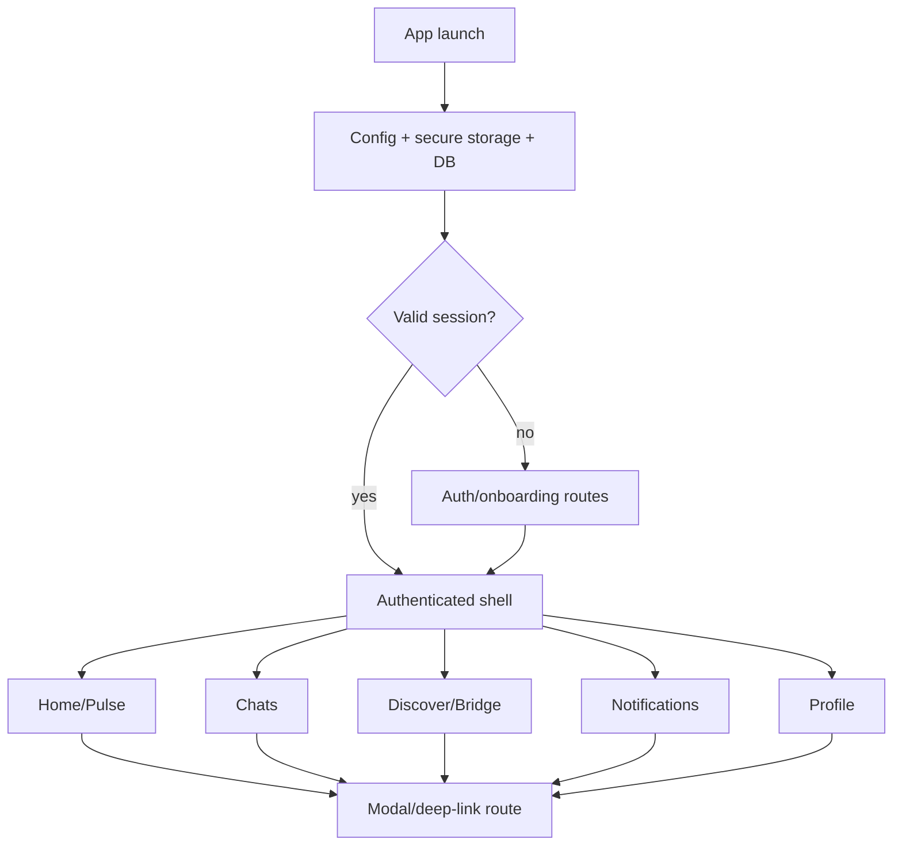
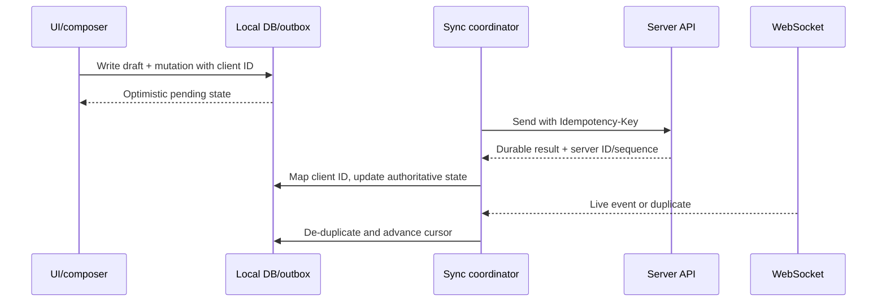

# Hiyall Flutter mobile architecture

**Status:** Architecture draft; local foundation implementation authorized on 7 October 2026

**Targets:** Android and iOS phones/tablets; future web-compatible domain contracts

**State management:** Riverpod with immutable state models

**Local persistence:** Drift/SQLite

**Networking:** generated OpenAPI client over Dio/HTTP; WebSocket event client

**Media/calls:** native-backed upload/cache and WebRTC integration behind interfaces
**Chat security:** mandatory E2EE library through reviewed native adapters; encrypted ratchet/outbox state, device verification and ciphertext-only transport

## 1. Mobile architecture goals

- Make the first useful social/chat loop fast on poor networks.
- Keep presentation state, domain rules, network DTOs, and persistence models separate enough to test.
- Make the server authoritative for privacy, membership, messages, and moderation.
- Support optimistic UI only where reconciliation is safe.
- Preserve original language, accessibility labels, and user-visible explanations for discovery/ranking.
- Avoid unnecessary rebuilds, unbounded lists, duplicate requests, and large in-memory media buffers.

## 2. Package and feature structure

```text
apps/mobile/
  android/
  ios/
  lib/
    app/
      app.dart
      bootstrap.dart
      router.dart
      theme/
      localization/
    core/
      auth/
      config/
      errors/
      networking/
      persistence/
      realtime/
      secure_storage/
      telemetry/
      media/
      accessibility/
      feature_flags/
    design_system/
      app_button.dart
      app_text_field.dart
      avatar.dart
      user_card.dart
      post_card.dart
      story_card.dart
      chat_bubble.dart
      bottom_sheet.dart
      modal.dart
      search_bar.dart
      filter_chip.dart
      empty_state.dart
      loading_state.dart
      error_state.dart
    features/
      onboarding/
      home/
      stories/
      posts/
      moments/
      discover/
      profile/
      social_graph/
      chat/
      calls/
      notifications/
      communities/
      events/
      privacy/
      settings/
      moderation/
  test/
  integration_test/
  pubspec.yaml
```

Each feature follows a pragmatic vertical slice:

```text
feature/
  presentation/     # screens, widgets, providers, UI state
  application/      # commands, use cases, orchestration
  domain/           # immutable domain models and policies
  data/             # API DTOs, Drift tables/DAOs, repository impls
```

The layers are boundaries, not a reason to create abstractions without a caller. A feature can keep a small folder until it has separate persistence, network, and presentation behavior.

## 3. Application shell and routing



Use `go_router` with:

- auth/session redirects;
- typed route arguments generated from route definitions;
- deep links for posts, profiles, stories, Moments, communities, events, and messages;
- restoration IDs for scroll position and modal state;
- no sensitive data in URLs;
- route-level analytics events that exclude message bodies and private fields.

### Bottom navigation

```text
Home / Pulse | Chats | Discover / Bridge | Notifications | Profile
```

Stories are the first horizontal surface on Home. Calls, settings, privacy, report, and create flows are nested or modal routes rather than bottom tabs.

## 4. State management and data flow

### State categories

| State | Example | Owner |
|---|---|---|
| Session/auth | token state, current user, device | Auth controller + secure storage |
| Server state | feed page, profile, chat history | Repository/cache providers |
| Local UI state | selected tab, composer draft, filter chip | Feature controller/widget |
| Durable local mutation | pending message/post/reaction | Drift outbox + sync coordinator |
| Ephemeral real-time | typing, presence, connection health | WebSocket coordinator, TTL state |
| Feature/config | rollout flags, kill switches | Config provider with cached defaults |

Use Riverpod providers for dependency injection and lifecycle. Use immutable `freezed`/JSON-serializable models for domain and presentation state. Avoid putting raw HTTP responses in widgets.

### Repository contract example

```dart
abstract interface class ConversationRepository {
  Stream<List<Message>> watchMessages(
    ConversationId id, {
    required int pageSize,
  });

  Future<SendMessageResult> sendMessage(
    ConversationId id,
    DraftMessage draft,
    {required String idempotencyKey},
  );

  Future<void> syncConversation(ConversationId id, {String? cursor});
}
```

Repositories coordinate cache, API, outbox, and event reconciliation. They do not decide UI presentation or bypass domain authorization assumptions.

## 5. Networking and API client

- Generate Dart DTOs/client interfaces from the approved OpenAPI document.
- Use Dio or a comparable HTTP client with timeouts, cancellation, compression, ETags, retry policy, and redacted interceptors.
- Access tokens are attached by an auth interceptor; refresh is single-flight so ten expired requests do not create ten refresh calls.
- Retry only safe reads and explicitly idempotent commands. Never blindly retry message/media creation without a key.
- Parse the standard response envelope into typed success/error results.
- Preserve `requestId`, error code, `Retry-After`, and server time for support/telemetry.
- Enforce max response size and pagination bounds.
- Support conditional requests (`ETag`/`If-None-Match`) for profiles/config where useful.

### Error taxonomy

```text
NetworkUnavailable       -> cached state + pending/retry UI
Timeout                   -> bounded retry or queued mutation
Unauthorized             -> refresh once, then session recovery
Forbidden/Hidden         -> privacy-safe message and no data leak
Conflict                 -> fetch latest + explicit reconciliation
RateLimited              -> show retry time, pause producer
Validation               -> field-level UI errors
ModerationRejected       -> clear user explanation, no hidden retry loop
ServerUnavailable        -> fallback/maintenance state with request ID
```

User-facing messages are localized and do not expose server stack traces.

## 6. Local database and cache

Drift/SQLite tables are a cache and offline queue, not a replacement for server authorization.

### Core local tables

| Table | Key | Retention |
|---|---|---|
| `cached_profiles` | `user_id` | LRU/TTL, invalidate on version |
| `cached_posts` | `post_id` | bounded by feed/history policy |
| `cached_feed_items` | `(surface, rank_cursor, post_id)` | disposable/rebuildable |
| `cached_stories` | `story_id` | until expiry plus small grace |
| `cached_conversations` | `conversation_id` | user-configurable recent history |
| `cached_messages` | `(conversation_id, sequence)` | bounded pages; tombstones retained for reconciliation |
| `cached_notifications` | `notification_id` | user-facing history policy |
| `drafts` | `(owner_id, draft_id)` | encrypted/local-only policy; sync optional |
| `mutation_outbox` | `mutation_id` | until ack/failure resolution |
| `sync_cursors` | `(resource,scope)` | durable resume cursor |
| `media_uploads` | `upload_id` | until complete/expired |

Rules:

- Store only the minimum personal data needed for offline UX.
- Encrypt the database or sensitive columns using a key protected by Keychain/Keystore where platform support permits.
- Do not log SQL rows or raw message content.
- Use schema migrations with forward/backward compatibility across app upgrades.
- Trim caches when storage pressure, account logout, deletion, or policy changes require it.

## 7. Offline-first mutation and synchronization



### Mutation classes

| Mutation | Offline behavior | Reconciliation |
|---|---|---|
| Message send | Queue and show `sending` | server sequence is authoritative; duplicate-safe |
| Reaction | Optimistic toggle | server result wins; last user intent wins if safe |
| Follow/friend request | Queue only if policy still valid | server status wins; show conflict |
| Post/story publish | Save draft; upload waits for network | media processing and moderation statuses |
| Profile edit | Local draft; conditional update | `If-Match` conflict UI |
| Privacy/block | Do not pretend remote success | send immediately when online; block requires clear pending state |
| Delete/report | Queue with high priority | visible workflow status; never silently discard |

### Sync coordinator behavior

1. Observe connectivity and app lifecycle, but do not assume background execution is unlimited.
2. Process mutations in dependency order with bounded concurrency.
3. Use exponential backoff with jitter and a maximum retry window.
4. Pause on auth failure, policy rejection, permanent validation error, or repeated provider failure.
5. Reconcile server cursors before declaring a mutation complete.
6. Send a `resume` cursor on WebSocket reconnect; if the server requests a full sync, use REST page cursors.
7. Keep failed mutations with a user-visible retry/discard path; never drop them silently.

## 8. Real-time WebSocket client

`RealtimeClient` is an isolated service with:

- authenticated handshake without long-lived tokens in URLs;
- heartbeat/ping and idle timeout;
- exponential reconnect with jitter and a max backoff;
- app foreground/background lifecycle handling;
- last-event cursor persistence;
- event schema/version validation;
- duplicate/out-of-order de-duplication;
- bounded in-memory buffer and backpressure;
- `sync.required` fallback to REST;
- connection quality state exposed to Chat and Calls UI.

The client does not treat presence as authoritative and does not use a permanent socket as the only push mechanism on mobile. APNs/FCM wakes the app when appropriate.

## 9. Media upload and local media handling

- Request a short-lived server upload session, then upload directly to object storage.
- Use multipart/resumable uploads with pause/resume and background task APIs where supported.
- Keep original bytes out of Dart heap where possible; stream from file handles.
- Social-media previews are for UX; server scan/transcode is authoritative for server-visible social assets. Chat attachments and thumbnails are prepared and encrypted before upload; the server cannot scan/transcode their decrypted content. In the app (Android and iOS only) a photo goes through `PhotoOutbox` (prepare, encrypt, upload each blob, complete, send, every step saved so a retry resumes), received photos through `ChatMedia` (hash check before decrypt, ciphertext-only file cache under `chat_blobs`, in-memory LRU of decoded images); see [encrypted chat attachments](../security/14-encrypted-chat-attachments.md).
- Render processing, rejected, quarantined, and ready states.
- Use image cache size limits, thumbnail-first loading, video poster frames, and viewport-based prefetch.
- Strip or minimise EXIF in the client preview; server repeats the policy check.
- Cancel uploads on logout/deletion. Stop issuing new private-media grants after a privacy change; existing signed URLs expire within the defined 60-second issuance window. See the residual-access policy in `docs/security/08-security-and-privacy.md`; client cancellation cannot revoke a downloaded copy.

## 10. Push notifications and deep links

- Register APNs/FCM token per device and rotate it when the provider changes it.
- Push payloads contain minimal data: notification ID, deep-link type, opaque object ID, and safe preview text if the user permits it.
- Do not place message bodies, email/phone values, or sensitive location in push payloads by default.
- Server-side notification preferences, block state, quiet hours, and grouping determine delivery.
- Deep links open a policy-checked route; the app never assumes that a previously valid object is still visible.
- Notification taps record an analytics event without copying private payloads into analytics.

## 11. Calls and native integrations

Create interfaces around platform-specific implementations:

```text
CallEngine
  - requestPermissions()
  - joinSignalingSession()
  - setMicrophoneEnabled()
  - setCameraEnabled()
  - switchCamera()
  - setSpeaker()
  - shareScreen()        # capability-gated
  - connectionQuality()
  - leave()
```

Use WebRTC with STUN/TURN, adaptive bitrate, ICE restart, network-change handling, and bounded reconnection. Native audio focus, background modes, CallKit/Android Telecom, Bluetooth routes, and notification permissions are implemented behind `CallEngine` adapters and tested on physical devices.

## 12. Design system and screen map

### Visual language

- Provisional Hiyall identity: calm “aurora” accent, neutral surfaces, high-contrast text, rounded but not decorative containers, and restrained motion.
- Light/dark themes use semantic tokens rather than hard-coded colours.
- Components expose loading, error, disabled, focused, selected, pressed, and accessibility states.
- Avoid relying on colour alone for viewed/unviewed, online, moderation, or message state.

### Reusable components

`AppButton`, `AppTextField`, `Avatar`, `UserCard`, `PostCard`, `StoryCard`, `MomentCard`, `ChatBubble`, `MessageComposer`, `BottomSheet`, `Modal`, `SearchBar`, `FilterChip`, `PrivacyBadge`, `ReasonLabel`, `EmptyState`, `LoadingState`, `ErrorState`, `MediaGrid`, `PaginationFooter`, and `AccessibleIconButton`.

### Screen inventory

1. Splash/bootstrap
2. Login, signup, verification, recovery, passkey/OIDC handoff
3. Onboarding: username, profile, interests, language, time zone, privacy, suggestions
4. Home/Pulse with stories, feed modes, create actions, post detail, Moment detail
5. Create post/story and media editor
6. Discover/Bridge, global search, filters, interest overlap, people profile
7. Notifications and deep-link detail
8. Chats, message request, 1:1 chat, group chat, chat info/media/search, call lobby/call
9. Communities, community detail, members, moderation, event detail/RSVP
10. Profile, edit profile, highlights, media, privacy center, security/sessions
11. Report/block/restrict/mute flows, appeal status, help/legal

## 13. Internationalization and accessibility

- Use ARB/string resources and locale-aware `intl`; no user-visible strings in widgets/controllers.
- Initial locale foundations for English, Hindi, Spanish, French, Arabic, Portuguese, German, Japanese, and Korean.
- Test RTL layouts with Arabic, dynamic text scaling, long translated strings, mixed scripts, and plural rules.
- Store and display IANA time zones; never format an event using device zone alone when organiser intent matters.
- Support VoiceOver/TalkBack semantic labels, logical focus order, minimum touch targets, contrast, reduced motion, and accessible error announcements.
- Provide text alternatives for media, captions/transcripts where available, and non-colour indicators for message/story state.
- Keyboard navigation is supported on tablets, desktop-sized layouts, and future web surfaces where applicable.

## 14. Performance and low-bandwidth strategy

- Keep cold start work minimal; defer analytics, large taxonomy, and non-critical caches.
- Use paged lists with item extent hints, image thumbnails, lazy video, and bounded prefetch.
- Avoid rebuilding the entire feed/chat tree; scope Riverpod providers by resource/cursor.
- Compress requests/responses, use HTTP caching/ETags, and expose a reduced-data mode.
- Prefer text/thumbnail fallbacks when bandwidth is constrained.
- Queue media uploads with resumable chunks and explicit progress.
- Instrument frame build/raster time, memory, jank, network bytes, cache hit rate, and battery/background work.
- Test slow 2G/3G, packet loss, app backgrounding, process death, clock changes, and network switching.

## 15. Mobile security and privacy

- Store credentials/tokens only in platform secure storage; clear sensitive state on logout/deletion.
- Do not hardcode secrets, provider API keys, or signing credentials in the app.
- Use secure deep-link association and validate all inbound route IDs server-side.
- Consider certificate pinning only with a documented rotation and emergency disable plan.
- Avoid screenshots on highly sensitive screens only where product/legal requirements justify the accessibility tradeoff.
- Redact logs, crash reports, analytics, clipboard previews, and notifications according to field sensitivity.
- Treat root/jailbreak detection as a risk signal, not the sole authorization control.
- Verify app integrity/attestation where available without blocking legitimate accessibility/testing environments by default.

## 16. Analytics and feature flags

Analytics events are versioned, consent-aware, and content-minimised:

```text
signup_started
signup_completed
onboarding_completed
post_created
story_created
story_viewed
moment_joined
message_sent
message_delivered
message_read
friend_request_sent
friend_request_accepted
profile_viewed
search_performed
community_joined
report_submitted
```

Do not include message bodies, raw search text, exact coordinates, tokens, or unnecessary identifiers. Use pseudonymous analytics IDs with deletion propagation.

Remote flags have safe local defaults, an expiry/owner, and a kill switch. Flags cannot bypass authorization, privacy, moderation, or required security checks.

## 17. Testing strategy

### Unit and property tests

- domain policies for visibility, blocks, friend states, feed modes, message lifecycle, cursor handling, and time zones;
- serialization/envelope parsing and backward-compatible event schemas;
- outbox ordering, idempotency, retries, de-duplication, and conflict resolution;
- accessibility semantics for shared components;
- property tests for pagination cursors and Unicode/RTL handling.

### Widget/golden tests

- authenticated shell/navigation;
- loading/empty/error/offline states;
- story/feed/post interactions;
- chat composer/message states;
- privacy/report/block flows;
- dynamic type, dark mode, RTL, and screen-reader labels.

### Integration/device tests

- signup/recovery/session revocation;
- create post/story with media processing;
- offline message then reconnect/deduplicate;
- WebSocket resume and push deep link;
- friend request/privacy/block propagation;
- community/event flows;
- calls on real Android/iOS devices and network switching.

### Operational tests

- slow/failed network, process death, disk pressure, background limits;
- API contract tests against staging;
- release smoke test, crash-free session gate, and rollback/kill-switch test.

## 18. Implementation dependencies and risks

### Dependencies

- Approved OpenAPI and event contracts.
- Identity provider, push certificates/keys, Apple/Google configuration.
- Media storage/CDN and moderation scanning policy.
- WebSocket gateway and TURN/WebRTC decision.
- Supported launch locales, legal/privacy retention, and data residency.
- Flutter/Dart version and package versions pinned during repository setup.

### Risks

1. Mobile background restrictions make permanent sockets unreliable; push and cursor sync are mandatory.
2. Mandatory E2EE requires a reviewed native cryptographic integration, device-key lifecycle, local search and explicit evidence sharing; server plaintext chat processing is prohibited.
3. Media and cache memory can dominate perceived performance; thumbnail-first behavior must be designed, not patched later.
4. Offline privacy changes are dangerous; block/delete/privacy commands need clear pending semantics.
5. Provider SDKs differ across iOS/Android; platform adapters and physical-device tests are required.

## 19. Fixed library and platform boundaries

Default library families are Riverpod, go_router, Dio, Drift/SQLite, platform secure storage, Firebase messaging for FCM/APNs registration, and a reviewed WebRTC adapter in the advanced phase. Pin exact compatible versions during setup, generate a lockfile and check licenses/security; these are chosen dependencies, not claims that unbuilt packages already work together.

Flutter's architecture guide separates UI and data concerns, and its offline-first guidance puts local/remote reconciliation behind repositories. Hiyall adapts that split to feature slices and Riverpod controllers; a repository is the single client entry point for cached and remote data, while the server remains authoritative for access and durability. [Flutter architecture](https://docs.flutter.dev/app-architecture/guide), [offline-first guidance](https://docs.flutter.dev/app-architecture/design-patterns/offline-first).

| Interface | Input/output contract | Test boundary |
|---|---|---|
| `IdentityAdapter` | PKCE transaction/provider verification/session token lifecycle | Provider mock and staging conformance; redacted errors |
| `SecureTokenStore` | Scoped session refresh material per account/device | Keychain/Keystore behavior, logout/process death |
| `ApiClient` | Typed OpenAPI request/result/ETag/request ID | Generated schema + status handling, 204/412/428/429 |
| `RealtimeClient` | Session-bound connection, typed events, opaque resume cursor | Duplicate/gap/edit/delete/revocation, bounded buffers |
| `LocalStore` | Encrypted cache/outbox and atomic event/cursor transactions | Account isolation, upgrades, disk-full recovery |
| `MediaUploader` | Upload session/parts/checksum/cancel/scan state | Network switch, expired grant, process restart, rejected scan |
| `PushAdapter` | Device-owned provider token and resource-only deep link | Token rotation, revoked device, denied permission |
| `SyncCoordinator` | Dependency-ordered mutations and revisions | Retry body mismatch, auth expiry, duplicate HTTP/socket acknowledgment |
| `AnalyticsSink` | Consent-gated event names + minimized fields | Opt-out, erase subject, no payload/PII leakage |

Sensitive local storage is mandatory for release: do not fall back to plaintext if encryption support is absent. Select a compatible reviewed SQLite encryption implementation (or encrypted sensitive columns with a documented threat boundary) and test on both platforms. Partition caches/outboxes by principal; logout removes keys and local data, cancels jobs/subscriptions, and never syncs one user's drafts under another's token.

Internationalization uses ARB keys and generated Flutter localization code for English, Hindi, Spanish, French, Arabic, Portuguese, German, Japanese and Korean. Shipping locales depend on reviewed translations; machine-generated untranslated strings are not counted as supported. Dates/numbers use locale formatters; transport uses UTC and preserved IANA zones. Monetary values remain currency + integer minor units for future commerce, with no floating point conversion.

Events specify an instant and organizer zone. Creation from local date/time requires resolving DST ambiguity explicitly: choose first/second occurrence when a time repeats, reject a nonexistent local time with an accessible alternative. Quiet hours are local wall-clock times in the user's chosen zone, reevaluated when offset changes; security alerts follow the mandatory security policy. Never assume every day is exactly 24 hours when scheduling recurring quiet windows.

Background sockets are best effort. OS background restrictions can defer upload/sync; keep durable pending state and reconcile at foreground wake. Token expiry, privacy/block pending state, storage pressure, cache retention and offline retry age are user-visible recovery states. The server may reject a queued command under new permissions, and the client must preserve the draft without repeatedly resending it.

## Chat screens (app)

The chat list and conversation are split by job: `features/chat.dart` holds the screens' state and the providers (search debounce, filters, scroll-to-latest state), `chat_list.dart` the rows, heading, search, filter chips, Meet card and empty/loading cards, `chat_header.dart` the 56 px header, `chat_thread.dart` the bubbles, typing dots and scroll button, `chat_composer.dart` the unified message dock, `chat_intro.dart` the dismissible new-chat card and skeleton, `chat_menu.dart` the conversation menu, `chat_parts.dart` small shared parts (atmosphere backdrop, icon button, encryption chip), `chat_format.dart` the pure helpers (relative times, grouping, filtering, preview mapping, auto-scroll and bubble-corner decisions) and `chat_photo.dart` the photo bubble, viewer and sheets. Colours come from the `ChatTokens` theme extension (`shared/chat_tokens.dart`), also used by `NavigationDock`; photo-less avatars use `shared/avatar_gradient.dart` through `PersonAvatar`. `AppShell` hides its header and the dock while `/chats/:id` is open. Nothing in `core/chat/` changed. `chatClockProvider` supplies "now" for relative times so tests are deterministic. Behaviour and look are described in [chat experience](../ux/14-chat-experience.md).
