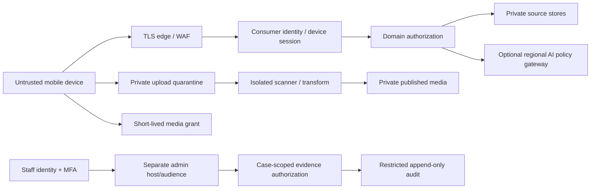

# Hiyall security, privacy, and threat model

**Status, 14 October 2026:** a control catalogue and launch checklist, partly implemented. Built and covered by automated tests: token verification, server-enforced onboarding, blocks, reports and an admin moderation console, per-account rate limits, minor/adult band isolation on block-checked paths, short-lived presigned media URLs, end-to-end encrypted chat text and photos, account deletion and export, health and metrics. Not done: any independent security or E2EE review, certification, real-device testing, age assurance, a load test, and the legal and market decisions below. Treat every control as unaudited. Policy owners must resolve jurisdictional obligations for selected launch markets before production.

## Mandatory encryption update

[Encryption and interception requirements](11-encryption-and-interception.md) supersede earlier server-visible-chat assumptions. Direct chats/attachments require device-side E2EE. Public/social content and voluntarily shared report evidence retain authorized server processing. The scan/transcode path below applies to server-visible social media, not encrypted chat bytes. The server never receives chat decryption keys or an automatic plaintext chat feed.

## Trust boundaries

Consumer tokens never authorize admin routes. Admin metrics use aggregates and account status; private messages are absent from ordinary user lookup. Case evidence is limited to reported items and explicitly supplied context, with purpose, scope, expiry, reviewer role, and audit. A broad “view all chats” capability is excluded. Human reviewers decide uncertain/high-impact sanctions; appeals use a different reviewer where possible.

## Authentication and account lifecycle

Default: external OIDC-compatible identity provider behind an Identity adapter, selected during implementation configuration. Do not invent an OAuth server. Mobile uses system-browser authorization code + PKCE (S256), state and nonce, exact allow-listed redirects, issuer/audience/signature/expiry validation, and verified provider subject mapping. Email/phone OTP uses a server-side verification provider; never trust a mobile SDK's “verified” flag. Apple/Google/passkeys are provider adapters with contract tests.

Access token lifetime: proposed 5 minutes. Refresh family maximum: 30 days, idle expiry: 7 days. Each successful refresh consumes the current token and records the next generation in one atomic transition. Retain used-token hashes through family expiry; replay revokes the family and triggers an alert. Serialize refresh on each device. A lost refresh response can require sign-in again; do not add a reusable grace token without a reviewed device-bound recovery protocol. OAuth security guidance requires rotation or sender constraining for refresh tokens in public clients. [OAuth Security BCP, RFC 9700](https://www.rfc-editor.org/rfc/rfc9700.html).

Store refresh material only in platform secure storage; access tokens live in memory. Device metadata is not proof of identity. One device can have multiple revoked sessions; a push token is not a session credential. Every protected API command checks live account/session status against the authoritative regional owner. Revocation changes stop new grants/writes; gateways invalidate session subscriptions and recheck on replay. If authority is unavailable, private reads and sensitive writes fail closed. Cached public content may continue without private metadata.

OTP defaults: five-minute expiry, one-use challenge, five attempts/challenge, 60-second resend delay. Response text/timing should avoid account enumeration. Step-up is short-lived and action-bound for export, deletion, new recovery methods, MFA changes, and logout-all. Staff MFA is mandatory; consumer MFA and passkeys available through the provider. If password credentials are enabled, use provider-managed salted adaptive hashing; no plaintext/password logs. Email/phone changes verify both ownership and recovery risk, revoke relevant sessions, and alert prior verified channels.

## Authorization and visibility matrix

| Resource / action | Authoritative rule | Failure behavior |
|---|---|---|
| Profile | Audience + per-field visibility + block + status | Omit private fields; return unavailable without distinguishing private/missing |
| Posts/comments/story | Parent audience, expiry, membership, moderation, block | Recheck on read/write; no stale-cache/index bypass |
| Follow/friend request | Target contact policy, pair block, cooldown, account reputation | Private follow becomes pending; recipient-only accept |
| Direct message | Accepted pair, active membership epoch, pair block, sender status | Deny before persistence, never acknowledge a rejected message as sent |
| Group history (advanced) | Membership intervals, history-access policy, roles | Removed member receives no future content; edits/receipts rechecked |
| Media URL issuance | Current object audience, owner/purpose, block; scan-ready social asset or validated ciphertext upload | No new grant after revocation; residual grant policy below |
| Search/recommendations | Candidate discovery opt-in and eligible public fields | Hydrate/re-authorize; suppress private totals/facets/snippets |
| Notification/deep link | Recipient ownership plus current referenced-object policy | Redact actor/content after block/delete; generic unavailable destination |
| Saved content | Collection owner + source still visible | Saving cannot preserve access to deleted/private source |
| Report/evidence | Reporter may report seen content; case reviewer needs specific scope | Quarantine evidence; log access; no arbitrary evidence URLs |
| Export/deletion/session | Principal owns job/session, live step-up where required | Action-scoped authorization, rate limits, safe job state |

For source writes racing a block/removal, serialize the pair-policy decision with the command in MVP through one regional transaction or locking protocol. Cross-module repository access remains explicit. At scale route pair/conversation authority to a single owner and fence its policy version; stale block caches never authorize a send. Client-side hiding is a UX aid only.

### CDN and offline access limits

A conventional signed URL is a bearer capability. It can be reused until expiry and cannot recall bytes already downloaded. Private grants expire after at most 60 seconds; do not issue long-lived share URLs for private assets. New grant issuance observes current authorization. Stop thumbnail/prefetch and purge controlled local caches on revocation/logout. CloudFront checks expiry when a request begins; an already started download may finish after expiry. [CloudFront signed URLs](https://docs.aws.amazon.com/AmazonCloudFront/latest/DeveloperGuide/private-content-signed-urls.html).

Therefore “instant block” means new server operations/grants are denied after the block commits; it does not mean revocation of existing copies or in-flight downloads. Highly sensitive assets that require per-request revocation need an edge authorization service backed by current revocation state, with fail-closed behavior, before that feature launches. General CDN invalidation alone is not user-level access revocation. The media API never proxies large uploads.

## Data minimization, residency, and retention

The first production deployment uses one selected home region and in-region Multi-AZ stores. No unrestricted cross-region personal-data replication is enabled. A launch-market matrix specifies acceptable regions and vendor subprocessors per data class: identity, message bodies, media, safety evidence, analytics, backups. Cross-border friendships do not silently change a user's storage region; route commands to resource ownership subject to that matrix. Region migration is an audited workflow with consent/policy evaluation.

No precise-location discovery or inferred sensitive attributes in MVP. Nearby exists and is opt-in for everyone (off by default, including every adult); the app reads the location only when Nearby is turned on after an in-app explainer or refreshed by hand (no automatic refresh, never in the background), the server stores one only when the client sends it, and it is rounded to a ~1.1 km grid before storage, expires after 24 hours (rows are purged after 7 days), and shows only distance buckets; its residual trilateration risk is in `docs/api/19-nearby-and-open-access.md`. Fields appear when the member's audience allows it, and new accounts default to open audiences; interest taxonomy excludes sensitive traits. Activity/online filters require user-controlled visibility and bounded coarse states, not a searchable exact activity log. The product is no longer adult-only (owner decision, minimum age 13, self-declared): there is no age assurance (the birth date is typed and can be falsified), minors and adults are kept apart only where blocks are checked (below), and age assurance, age-banded discovery and regional child-safety rules still need a separate implementation choice before signup launch (see the safety note in `docs/api/19-nearby-and-open-access.md`). Birth dates are kept privately (`member_ages`) and put each member in the minor or adult age band, which are kept apart on every path that checks blocks (`AGE_BAND_ISOLATION`); the age filter works on that date and no search or Nearby result carries an age. A member's age in whole years is shown on their profile to same-band members who may open it (default audience everyone, no app control), never the date. Messaging is open: anyone not blocked and in the same age band can start a conversation (no friendship or follow needed, minors included within their band), limited by blocks, reports, the age barrier and a new-conversation limiter (burst 10, then one a minute); that raises contact risk and its recommended follow-ups (message requests for under-18s, stranger-message limits, link and media restrictions, safety nudges, moderation staffing) are listed and not done in `docs/api/19-nearby-and-open-access.md`. Profile visits (which member opened which profile) are stored once per pair; the owner sees the named list of their own visitors (`GET /v1/me/visitors`, the most recent 200 on the free plan, no route shows anyone else's), and others see only the count (`counts` audience). This document is an engineering control proposal, not a global legal compliance finding.

| Data class | Proposed retention default | Erasure / exceptions |
|---|---|---|
| Public posts/profile/media | Until user deletion, with explicit archive choices | A deleted post, comment or space entry is hidden at once; its text is blanked within a day by the hourly `deleted content blanking` job and the row (with a post's comments, reactions, saves and counters) is deleted 30 days after deletion by `deleted content purge`; content named by an open report is kept until the report closes. Photo objects go through the media cleanup and the finished photo row 30 days later (`media tombstone purge`) |
| Ordinary messages | Until deleted or a selected disappearing policy expires | Ciphertext goes on delivery (7 days after delivery at the latest, 30 days if never delivered). The metadata row (id, sender, time; no content) is deleted after 180 days by `message metadata retention` once no envelope is waiting, no attachment hangs on it and no report names it as evidence; each member's latest non-reaction message in a conversation is always kept because the reply rule reads it. Other participants' retained copies follow disclosed policy |
| Stories/views | Visible 24h; purge unhighlighted source/views within 7 days | Highlights are explicit archive copies with their own audience |
| Unaccepted requests | Expire after 30 days; decline/request cooldown metadata 90 days | No public receipt/activity trail |
| Consumer notifications | 90 days (built: hourly `notification retention` job) | Remove/redact deleted-object payloads |
| OTP challenge/hash | Until expiry plus abuse audit metadata without code | One-use hash; verification code never logged |
| Sessions/rotated hashes | Family lifetime plus security metadata policy | Secret/token hashes unavailable in user/admin lists |
| Product telemetry | Raw event metadata 30 days; aggregated trends 13 months | Pseudonymous subject erasure; no raw message bodies |
| Security/admin audit | 365-day minimum, enforced by the database (nothing younger can be pruned; older entries are removed only by an administrator, in audited batches); archive duration set by market policy | Restricted, purpose-based, minimal actor IDs; no content text |
| Report evidence/actions | 180 days after closure unless hold/policy exception (built: hourly `closed report retention` job; a report whose encrypted evidence is held, `chat_blobs.held_report_id`, and every open report are kept) | Human-approved retention; appeals need necessary evidence |
| Backups | 35-day rolling source backups by default | Not selectively mutable; isolation and deletion-ledger replay after restore |
| Export files | 7 days availability; one-hour reauthorized download grant | Encrypt; revoke download grants on session/account risk changes |

These defaults need launch-policy approval; hold exceptions are purpose-limited, documented, access-restricted, and never used to retain everything. Deletion status can distinguish hidden, processing, policy-retained, and complete. Do not label erasure complete while required stores are outstanding.

Deletion workflow (built; details and retention table in [account deletion and export](../api/22-account-deletion-and-export.md)): the member types their username and must have signed in within the last 5 minutes (`REAUTH_REQUIRED` otherwise) → `POST /v1/me/deletion` puts the account in `pending_deletion` with a 30 day grace period, revokes every session, clears push tokens and closes live sockets in one transaction, and the member disappears from every other member's view and counts at once → during the grace period the member can sign in but the API serves only `GET`/`DELETE /v1/me/deletion` and sign-out (everything else is the ordinary inactive-account 401), which is the restricted status-and-cancel access this document calls for → after `deletion_due_at` the hourly `maintain` job purges per store in resumable, idempotent steps (content and relationships in bounded batches of at most 1000 rows, each batch its own short transaction that first checks the account is still `deleting`, so a large account never holds one long transaction; object removal through the existing media and chat-blob cleanups, then the Firebase user through the Identity Toolkit REST API when `FIREBASE_SERVICE_ACCOUNT_FILE` is set) → the `users` row stays as a tombstone with no personal data (`deleted_users` records id and time). Retained on purpose: open reports and reports holding encrypted evidence (with the held attachment, its message and conversation row and the sender device's public keys), resolved reports that led to an action against someone else (without the reporter's text), the admin audit log and backups. A test enumerates every foreign key to `users` and fails when a table is neither purged nor listed as retained. Export: `GET /v1/me/export` streams one JSON document (once per 24 hours per member, server-enforced; the date of birth, coordinates, tokens and report evidence are never included; chat content cannot be, being end-to-end encrypted); it requires a live session, not a separate step-up, today.

Every store adapter records evidence of completion: source rows, media variants, search, feed, caches, notification payloads, AI features, third-party processor requests, and analytics subject mapping. Restore applies the durable deletion ledger before enabling traffic. Trained-model impact and legally retained evidence require documented processor policy and truthful exceptions rather than promises of magical removal. Human review governs holds and contested deletion.

## Distributed limits and anti-abuse defaults

| Operation | Initial account/device budget | Additional dimension |
|---|---|---|
| OTP send | 3/hour per identifier; 10/day | Provider spend caps; coarse IP/device adaptive challenges |
| Verification | 5/challenge; 10/min device | Risk-based cooldown, not permanent IP ban |
| Friend/message requests | 20/day new account; 100/day established | Recipient budget, decline cooldown, safety risk |
| Chat send | 60/min account; 30/min conversation | Payload size, bulk recipient spread, suspicious links |
| Post/comment | 10 posts/hour; 30 comments/min | Target congestion and account reputation |
| Search | 30/min account burst 10 | Enumeration/page cap; no sensitive aggregates |
| Upload | 20 sessions/hour; daily byte quota configured | Size/type/owner; abandon-multipart cleanup |
| Reports | 20/hour baseline | Never silently discard urgent reports; risk-based challenge/escalation |

These are staging defaults to tune with legitimate global usage, not universal final values. Redis atomic token buckets apply account/device/endpoint controls; local edge/IP budgets absorb attacks without penalizing shared mobile carrier NATs indiscriminately. If Redis fails, fail closed for OTP and anonymous high-cost operations; use strict local temporary budgets for established low-risk requests, flag degraded protection, and cap fleet scale. Local fallback is not a replacement for distributed enforcement. Multi-region limits have region-owned quotas; do not assume asynchronous counter replication is exact.

Detect bulk messaging, graph churn, fake-account patterns, links, account reputation, and compromised devices while minimizing retained identifiers. Human intervention and appeal exist for restrictions. Captcha/accessibility alternatives are risk-triggered. Never use IP alone to classify a user or make a permanent sanction.

## Threat model

Priority describes inherent risk before proposed controls, not a compliance rating.

| Threat | Risk | Mitigation | Detection | Response |
|---|---|---|---|---|
| Account takeover | Critical: user impersonation/data access | Passkeys/MFA, action-bound recovery, short tokens, rotation | New-device/provider anomalies, reuse events, user reports | Revoke family, freeze sensitive actions, verified recovery, incident review |
| Credential stuffing | High: many compromised credentials | Provider risk checks, device/account budgets, breached-password controls if enabled | Failed-login distribution, success after attack bursts | Challenge/throttle campaign, alert affected users, revoke compromised sessions |
| OTP abuse | High: costs and unauthorized enrollment | One-use expiry, retry limits, spend guardrails | SMS/email spend and send/verify ratio | Disable affected flow/provider region, keep alternate recovery, investigate |
| Fake accounts/bots/spam | High: harassment and unsafe discovery | Reputation, bounded requests, behavior limits, opt-in discovery | Request declines, repetitive links, graph churn | Restrict capability, human review, appeal and restore if mistaken |
| Scraping | High: public-data aggregation | Minimal public fields, bounds, bot budgets, no private facets | Enumeration cursor use and systematic profile requests | Reduce capability, invalidate abusive sessions, investigate exposure |
| DDoS | High: service unavailable | CDN/WAF, ingress caps, dependency isolation, queue budgets | Saturation, handshake bursts, error-budget burn | Edge mitigation, shed noncritical load, isolate regions/endpoints |
| API abuse/cost attack | High: expensive AI/media/search | Per-feature quotas, provider budgets, job dedupe | Cost per principal/operation, queue age | Kill switch expensive feature, cancel queued abusive jobs, review |
| Broken authorization | Critical: cross-user/private data leak | Central domain policies, live versions, composite target checks | Negative tests, policy audit, inaccessible-object probes | Quarantine route/feature, revoke grants, assess data and notify under policy |
| Data leakage | Critical: identifiers/content/secrets | TLS/KMS, scoped IAM, redaction, least privilege | Secret scanning, access anomalies, sanitized log sampling | Rotate keys/credentials, isolate store, scope incident, restore safe access |
| Malicious uploads | Critical: malware/exploit content | Social assets: quarantine/scan/sandbox. E2EE attachments: client safe decode/file controls, byte quotas and explicit reports; server cannot inspect plaintext | Social scan failures; encrypted relay anomalies and reports | Quarantine authorized reported evidence, revoke asset delivery, patch decoders, case review |
| XSS/deep-link injection | High: admin/session takeover | Escape text, admin CSP, no raw HTML, validated HTTPS links/routes | Browser security tests, CSP reports, link fuzzing | Disable offending render path, revoke impacted sessions, sanitize indexed data |
| SQL/search injection | High: source/index compromise | Parameterized SQL, bounded typed queries, no raw query DSL | Fuzzing, query failures, suspicious operators | Restrict endpoint, preserve evidence, patch and replay safe requests |
| Session theft/replay | Critical: persistent access | Secure storage, rotation history, separate audiences, no URL tokens | Token reuse and device risk, revoked-session accesses | Family revoke, user warning, device/session review |
| Insider misuse | Critical: private-data abuse | Separate admin plane, case scopes, mandatory MFA, audited break-glass | Evidence-read audits, excessive lookup/export alerts | Suspend staff role, preserve immutable audit, independent investigation |
| Moderation error | High: wrongful ban or delayed harm response | Human review, severity queue, policy versions, appeals | Quality samples, overturn rate, overdue urgent cases | Restore/compensate mistaken action, retrain review, escalate urgent backlog |
| Dependency/supply-chain compromise | Critical: shipped malicious code | Pinned locks, SBOM, signed builds, scans, OIDC CI roles | Dependency/image/IaC findings, artifact integrity checks | Block release, rotate CI credentials, rebuild known-good artifact |

## Required security verification

For each resource, two-user negative access tests cover direct IDs, nested-parent mismatch, stale caches/indexes, revoked sessions, wrong admin audience, blocked-pair races, and replay. Race tests cover refresh generation, concurrent request acceptance, message retries, and membership/visibility changes. Upload tests include polyglots, oversized decompression, malicious filename/MIME, and attempted foreign-owner attachment. No actual security test has run during this design phase.

Before production: identity/provider conformance, threat review, mobile secure-storage behavior on real devices, exported-data access, restore/deletion replay, audit access review, dependency/SBOM scans, incident tabletop, and independent penetration testing. Network pinning or device integrity checks are adopted only with a rotation/recovery/accessibility plan; neither replaces server authorization.
