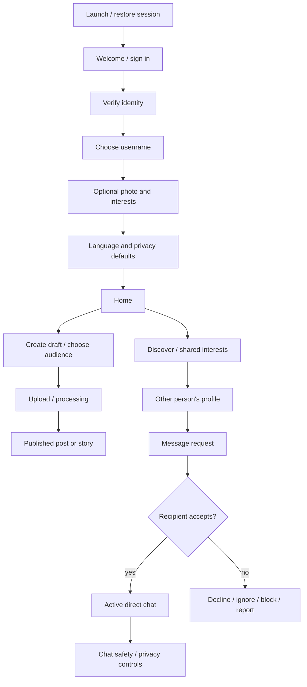

# Hiyall UX and design system

**Status:** foundation screens implemented and visually redesigned, 7 October 2026. Feature flows beyond profile/privacy/session management remain a roadmap.

## Brand and interaction direction

Hiyall uses an expressive, playful visual direction: lime, lilac, pink and mint against warm cream and near-black; large Space Grotesk headings; Manrope interface text; rounded cards; and original vector art with smiles, stars and orbits. Fonts are bundled locally with their SIL Open Font License files in `apps/mobile/assets/fonts`, with no remote font requests. The brand mark is an eight-point star in a lime rounded square. Brand clearance precedes public release.

Implemented layouts use a floating dark bottom bar on phones and a 238-pixel sidebar at widths of 900 pixels or more. Reading width is capped at 1060 pixels. Hero and paired-card layouts become stacked on narrow screens or at large text sizes. Profile identity and preferences sit beside each other on wider screens. Every feature screen has its own headline, illustration and supporting layout; unavailable features have explicit coming-soon text, with no fabricated conversations, notifications or social counters.

Use familiar labels Home, Chats, Discover, Notifications, Profile. Pulse and Bridge can appear as supporting feature names without requiring first-time users to learn them. Stories remain at the top of Home. Create is a contextual toolbar action, not a sixth tab. Groups, communities, events, calls, and timed Moments enter through Chats/Discover in the advanced release.

## Essential user flows



Onboarding can skip optional photo, location, profession, education, and interests. Set a system-derived language/time zone that the user can change. Before the first post or request, explain the relevant audience/contact default in context. Do not request contacts, microphone, camera, or location until the feature needs them. A permissions denial always has a usable alternative.

Privacy defaults (owner decision, October 2026; supersedes the earlier friends-only design): profiles are public and discoverable; every field is visible; the followers and following lists open to followers (friends only for minors); messages from friends; strangers use bounded requests; last seen hidden; online shown, with one "show when I'm online" toggle as the only member control for now; precise location is never stored. Nearby is coarse and expiring and shown as distance buckets (the app sends the position automatically; see the safety note for what that means without an in-app opt-out) ([Nearby and open access](../api/19-nearby-and-open-access.md)). Share only the profile fields a member shows on discovery cards. Age filters remain unimplemented and no sensitive-trait filters are accepted.

## Screen inventory and route map

| Screen | Entry / purpose | Release |
|---|---|---|
| Splash/bootstrap | Session restoration and cache migration; never an artificial delay | Foundation |
| Welcome/login/signup | Identity choices, accessible email/phone entry, provider handoff | MVP |
| OTP/recovery/MFA | Single pasteable code, expiry, resend budget, recovery and step-up | MVP |
| Username/onboarding | Username reservation, optional photo/interests, language/privacy | MVP |
| Home | Stories, feed mode selector, bounded feed, refresh, draft/create entry | MVP |
| Story viewer/editor | Timed playback, pause, captions, audience, reply/report | MVP photo/video/text; stickers later |
| Create post | Draft, text/media, alt text, audience, upload status | MVP |
| Post details/comments | Original post, bounded replies, react/save/report | MVP |
| Search | People/posts tabs, suggestions, clear history | MVP; communities/events later |
| Find Friends | Interest/category cards, opt-in filters, explanation, request/follow | MVP |
| Profile/edit profile | Cover/avatar, bio, passport, posts/media; own/private saved content | MVP |
| Notification center | Grouped social/security items, unread state, preferences | MVP |
| Chat list | Recents, requests inbox, drafts, unread/muted indicators | MVP |
| Request detail | Limited introduction, profile context, accept/decline/block/report | MVP |
| Direct chat | Durable messages, receipts, attachments, safety menu | MVP |
| Settings | Language, appearance, quiet controls, Help, account lifecycle | MVP |
| Privacy Center | Contact/discovery/visibility controls, audience preview | MVP |
| Security/devices | Sessions, MFA, login events, logout, recovery | MVP |
| Export/deletion | Step-up, retention summary, job progress, download expiry | MVP |
| Report/block sheet | Reason, optional context, acknowledgment, block choice | MVP |
| Help/appeal status | Safety guidance, own report/appeal status | MVP |
| Group chat / calls / history | Member roles, voice/video controls, quality, call records | Advanced |
| Communities/detail | Rules, join request, topics, moderation, posts | Advanced |
| Events/detail/editor | Organizer zone, local time, DST ambiguity, RSVP/reminders | Advanced |
| Moment detail/create | Timed space, rules/capacity, host moderation, archive | Advanced |

Deep links contain resource IDs only, with server authorization after session restoration. Deleted, blocked, private, expired, and unknown objects share a privacy-safe unavailable state. Never show cached private content under a different signed-in account.

## Mobile wireframes

These are spatial wireframes, not final rendered mockups. Wide tablets keep the same destinations in a navigation rail, use a two-column chat layout, and constrain reading width rather than stretching every card.

```text
HOME                                DISCOVER
┌─────────────────────────────┐     ┌─────────────────────────────┐
│ Hiyall               [+]   │     │ Discover               [⌕] │
│ [Your story] [Aya] [Niko] →  │     │ Find people through shared │
│ For you  Friends  Following │     │ interests                  │
│─────────────────────────────│     │ [Photography] [Tech] [+]    │
│ [avatar] Aya      · 2h  […]  │     │ [Global] [Language] [More]  │
│ Shared interest: photography│     │─────────────────────────────│
│ Short post text…            │     │ [avatar] Niko    [Follow]   │
│ [responsive image + alt]    │     │ 3 shared interests         │
│ ♡   Comment   Share    Save │     │ Travel · Art · Photography │
│─────────────────────────────│     │ [Profile] [Send request]    │
│ Next card / loading state   │     │ Why this suggestion?       │
│                             │     │─────────────────────────────│
│ Home Chats Discover Bell Me │     │ Home Chats Discover Bell Me │
└─────────────────────────────┘     └─────────────────────────────┘

CHAT                                PRIVACY CENTER
┌─────────────────────────────┐     ┌─────────────────────────────┐
│ ‹ [avatar] Aya   [Details]   │     │ ‹ Privacy Center            │
│ Last seen hidden            │     │ Your choices               │
│─────────────────────────────│     │─────────────────────────────│
│            Today            │     │ Who can contact me         │
│ [Original message]          │     │ Messages      Friends    › │
│ [Translate] (later feature) │     │ Requests      Everyone   › │
│           [My message] ✓✓   │     │ Who can see me             │
│        [Pending message] ◷  │     │ Profile       Friends    › │
│                             │     │ Stories       Friends    › │
│ Offline · messages queued   │     │ Activity      Hidden     › │
│─────────────────────────────│     │ Who can find me            │
│ [+] [Message…]       [Send]  │     │ Discovery     Opted out  › │
│ Keyboard / safe inset       │     │ [Preview my visibility]    │
└─────────────────────────────┘     └─────────────────────────────┘
```

## Design tokens

| Token | Light | Dark / behavior |
|---|---|---|
| Background | `#F7F8F2` | `#191C18` |
| Surface | `#FFFFFF` | `#272B26` |
| Main text | `#20231F` | `#F5F6ED` |
| Secondary text | `#60665B` | `#C0C5B8` |
| Primary action | `#D2F65A` + `#20231F` text | Same |
| Illustration accents | Lilac `#D8C9FA`, pink `#F6BED4`, mint `#C4E8DA`, peach `#FFD1B5` | Ink foreground on pastel panels |
| Focus outline | 2 logical pixels accent | Theme-aware focus color |
| Spacing | 4, 8, 12, 16, 24, 28, 32 logical px | Direction-aware insets |
| Radius | Inputs 16; buttons 18; cards 28; navigation 25 | Decorative tags use pills |
| Typography | Space Grotesk headings 36–54; Manrope body 14–16 | OS scaling; no fixed card heights around text |
| Motion | Navigation selection 160ms | Zero-duration selection with reduced motion |

Colors are proposed tokens, not certified contrast results. During implementation measure every actual foreground/background, including pressed/disabled states; target body text 4.5:1 and large text/UI indicators 3:1. Use a minimum 48×48 logical-pixel actionable area, descriptive semantics, readable text at 200% scaling, and labels alongside unfamiliar icons. Story state uses an accessible label as well as a ring color. Delivery uses text/semantics alongside ticks; do not announce every typing update.

## Component hierarchy and contracts

```text
AppShell
  Floating NavigationBar / Desktop sidebar
  FeatureScreen
    SurfaceHeader + SearchBar + FilterChip
    PaginatedList
      StoryCard / UserCard / PostCard / ChatBubble
        Avatar + AppText + MediaPreview + ActionRow
    Composer / Form
      AppTextField + AudienceSelector + AppButton
    LoadingState / EmptyState / ErrorState / OfflineBanner
  BottomSheet / Modal
    ReportForm / BlockConfirmation / PrivacyPicker
```

| Component | Required behavior |
|---|---|
| AppButton | Label, semantic action, loading/disabled, one submit while pending |
| AppTextField | Label, Unicode input, safe obscuring, inline validation, paste support |
| Avatar/UserCard | Fallback initials, image errors, shared-interest reasons, no hidden field leak |
| PostCard | Versioned content, audience indicator, media ratio, privacy-safe unavailable state |
| StoryCard | Viewed state, expiry, captions, pause gesture plus accessible pause control |
| ChatBubble | Client/server IDs, pending/failed/retry, reply context, original text, deleted tombstone |
| BottomSheet/Modal | Focus trap, explicit close, keyboard/safe insets, restored focus |
| SearchBar/FilterChip | Clear query, debounced requests, selected semantics, announced filter count |
| Empty/Loading/Error | Distinguish no results/offline/blocked; retry with request ID only where useful |
| AudienceSelector | Visible choice before publication; last audience never silently widens |

## Interaction edge cases

- Optimistic likes/save can roll back; a failed message stays with Retry/Discard. Offline privacy changes read “Waiting for connection,” never “Saved.” Blocking hides cached content locally immediately but shows pending remote enforcement until acknowledged.
- Feed loads 20 items, prefetched only near the end; preserve scroll on returning from details. Pull-to-refresh starts a new rank epoch without duplicating an existing card.
- A request contains no private message content before acceptance; show only authorized profile/shared-interest context. Never reveal read/online indicators before acceptance. Decline is private; repeated requests have a cooldown.
- Media is thumbnail-first; show total size before downloading a large attachment on a metered network. Data Saver disables video autoplay/prefetch.
- Render text with natural reading direction while keeping layout direction from locale. Mixed-script usernames/links receive plain, clear rendering; never use direction changes to conceal link destinations.
- Story audio is off until the user chooses sound. Calls request microphone/camera just in time; state permissions, connectivity, and recording policy explicitly.

## UX verification gate

Before MVP launch, test first signup, first post, first consent request, offline retry, block/report, and account deletion on Android and iOS with VoiceOver/TalkBack, large fonts, reduced motion, Arabic RTL, and simulated slow networks. Include meaningful usability sessions with users across launch locales. Wireframes do not count as passing these tests.

## Foundation redesign validation

Widget checks traverse all eight implemented routes at 320×740, 390×844 and 1440×1000 logical pixels, in light and dark modes, with normal and 200% text scaling. The signed-out welcome screen also has a small-screen/200% check. Optional `CAPTURE_DESIGN=true` writes local fixture renders to `.runtime/design-previews` for visual inspection; these are Flutter widget renders, not device or browser screenshots. Privacy success/failure, unblock and session recovery tests remain in place. Device assistive technology and browser interaction checks remain part of the launch gate.
