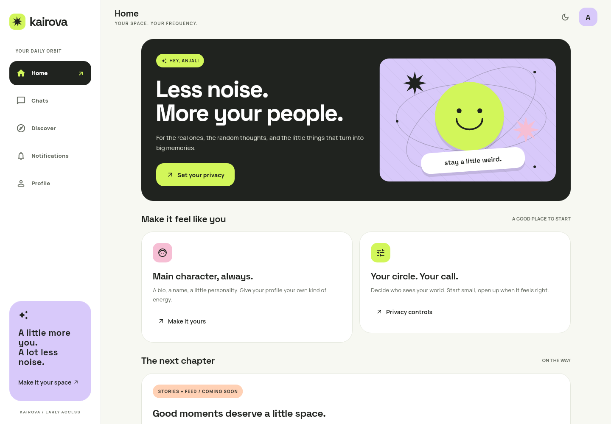
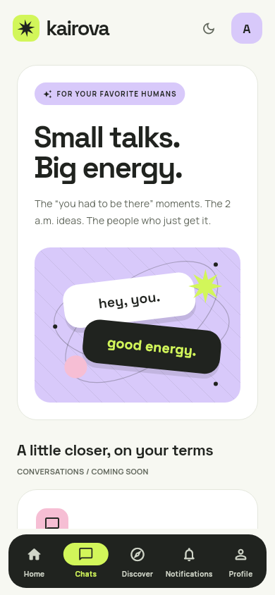
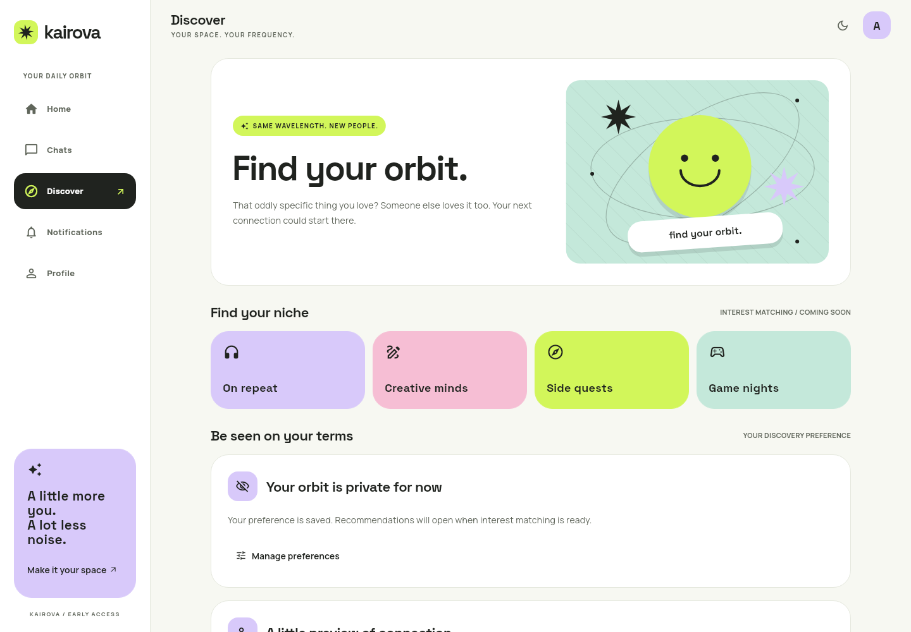
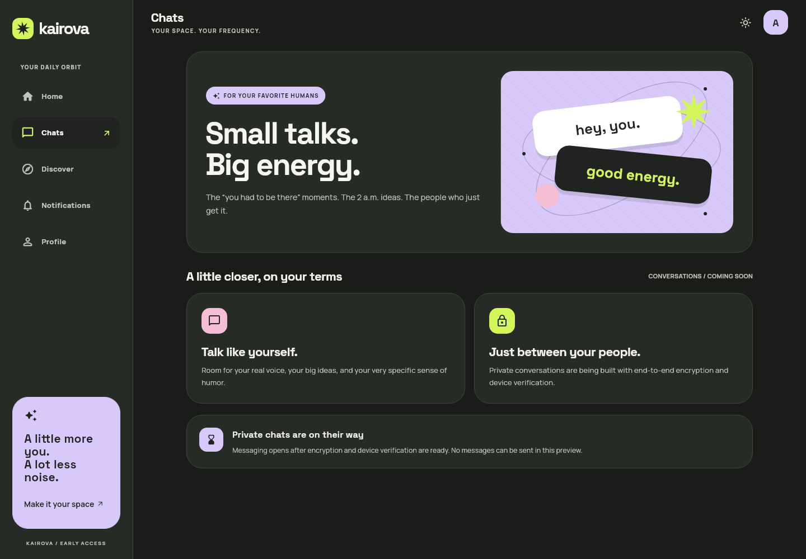
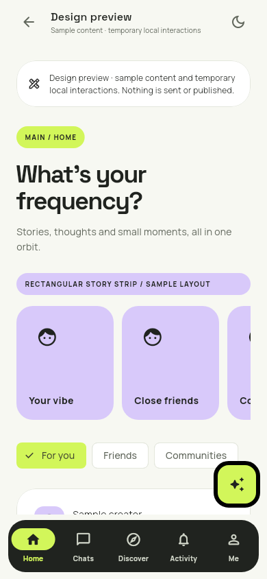
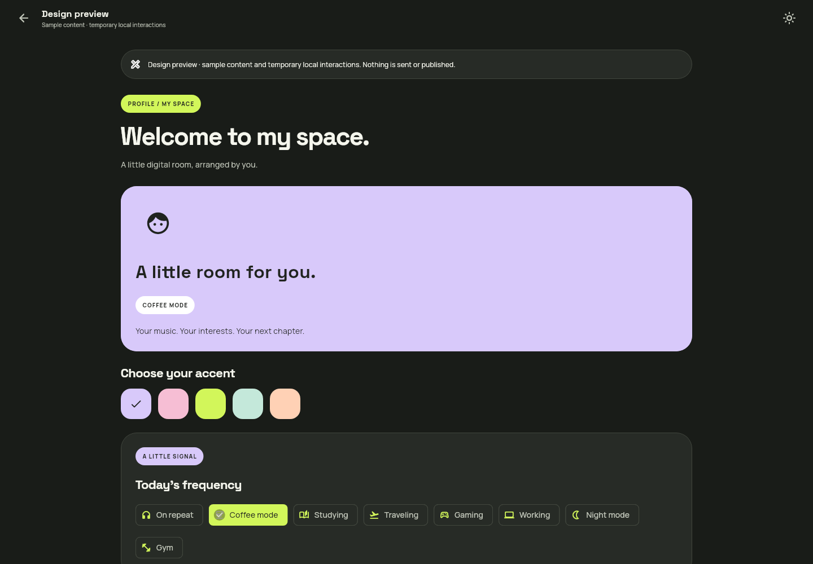
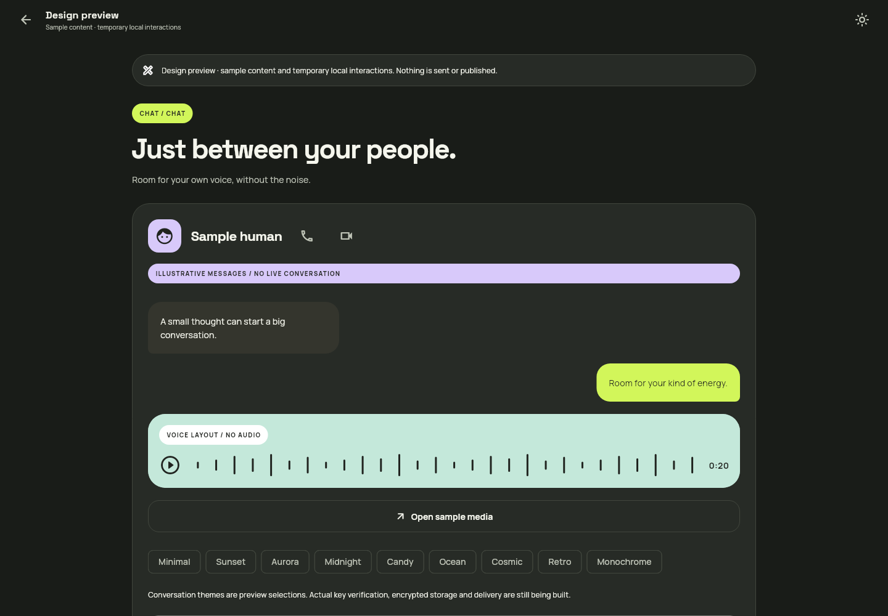
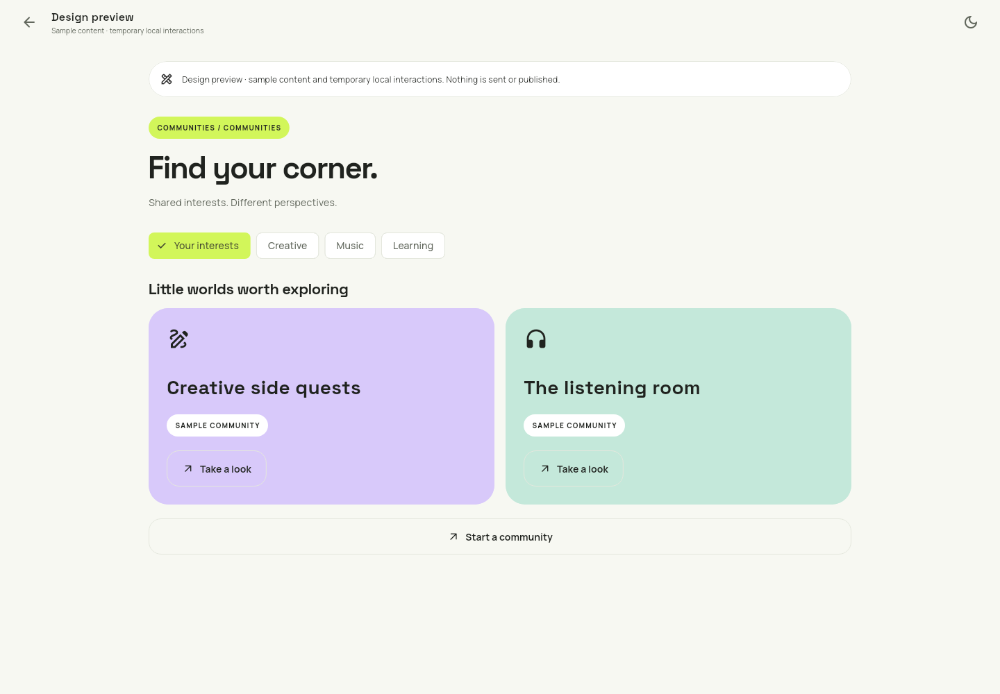

# Kairova: the next social space

Design specification and Flutter implementation map · 7 October 2026

This specification answers the Gen Z UI/UX brief before extending the implementation. The existing foundation supplies working profile editing, privacy, blocking and session management. All other screens below are interactive design previews until their corresponding API and security work is implemented. Preview examples must be visibly marked; no fabricated social activity appears as real account data. Chat sending, calling, publication and production sign-in remain unavailable.

## Brand and personality

**Concept: your orbit.** People have many overlapping interests and changing moods. Kairova gives them a small digital space in which to express themselves and meet people through context, rather than chasing public popularity. Its signature is a lime star, an orbit line and a playful ambient smile. The line connects illustrations, profile covers, the creation orb and interest tiles.

The voice is warm, short and clear: “Meet your people,” “Share your world,” “Good vibes. Clear boundaries.” Slang is occasional and natural. No forced hype, streak pressure, countdown anxiety or exaggerated security promises. Names remain Home, Chats, Discover, Activity and Me where labels fit; descriptive labels remain available to assistive technology. Familiar destination names avoid requiring users to learn metaphors to navigate.

## Visual language and semantic tokens

Geometric display type sits beside restrained body text. Cream and ink form the quiet base. Lime identifies primary actions; lilac frames conversation and identity; pink signals expression; mint frames discovery; peach frames activity. Vivid accents occupy small areas. White/charcoal surfaces, outlines and spacing establish layering without heavy shadows or glass blur. Rounded rectangles, cut-corner editorial panels, pill tags and stars create shape variation. Decorative graphics contain no essential information.

| Token | Light | Dark | Purpose |
|---|---|---|---|
| background | #F7F8F2 | #191C18 | Page canvas |
| surface | #FFFFFF | #272B26 | Controls and readable layers |
| elevated | #F0F2E8 | #30362E | Secondary surfaces |
| text | #20231F | #F5F6ED | Body and headings |
| muted | #60665B | #C0C5B8 | Supporting text |
| primary / accent | #D2F65A | #D2F65A | Primary actions with ink text |
| secondary | #D8C9FA | #D8C9FA | Identity and conversation art |
| success | #246846 | #9EE4B5 | Confirmed server success |
| warning | #8B5A14 | #F6CD7B | Pending/review needed |
| error | #B42335 | #FFB4BF | Failed action and validation |
| info | #564383 | #D8C9FA | Neutral contextual notices |
| pink / mint / peach | #F6BED4 / #C4E8DA / #FFD1B5 | Same with ink text | Supporting illustration surfaces |

Typography: Space Grotesk display (42–54, bold), page heading (36–44, bold), section heading (22, semibold); Manrope body (14–16, regular), label (14, bold), caption (11–12, medium), username (14, semibold), stats (20, bold). Two primary font families bundled locally, SIL OFL licenses included. Their loading requires no remote font requests; non-Latin fallback fonts still need device/browser verification. Text scales with system settings; columns stack at 200%.

Spacing: 4/8/12/16/24/28/32/44. Radii: 8 for small editorial accents, 16 inputs, 18 controls, 28 primary surfaces, 100 tags. Elevation: flat default; one subtle shadow for floating creation/navigation, modal elevation only when necessary. These map to Flutter theme/component constants, not separate per-screen styles.

## Information architecture and navigation

```
Welcome → visual intro → sign-in / signup → verification → interests / language / profile
Home → story strip / feed → story / post detail → comments / reactions
     → creation orb → post / story / vibe / poll / question / event / community
Chats → new chat / requests → direct / group chat → media / voice / call
Discover → topics / search / find people → profile / community / event
Activity → All / Social / Messages / Communities / Mentions
Me → Posts / Vibes / Media / Communities / About → My Space
   → settings → account / privacy / security / appearance / language / support
```

Phones use five destinations in a floating ink bar. Wide layouts use the same five destinations in a 238-pixel sidebar; primary reading width remains 1060. Creation is contextual to Home, never a sixth navigation destination. Back preserves the parent context. No critical action requires a gesture. The separate **Design studio** groups all preview screens by feature, keeps a persistent preview label and allows comparison without pretending the feature is deployed.

## User flows and permissions

1. Welcome → explore four visual statements → choose an identity provider → verify identity → choose optional interests/language/profile → review privacy → Home. Provider controls show their unavailable state until actual provider configuration exists. Never simulate OTP success.
2. Creation orb → choose content type → compose → review audience → publish only after server acknowledgment. Preview drafts remain in memory, never displayed as published content. Story capture must explain camera permission and offer upload alternatives.
3. Discover → an explainable category → authorized person/community → view → request/follow → recipient choice. No unexplained match percentages, fake mutual counts or inferred location. Nearby discovery requires explicit location consent.
4. Chats → recipient consent → device verification → encrypted conversation → media/call controls. Preview text never becomes a sent message. Voice, camera, location and contacts permissions are requested only by implemented features needing them.
5. Profile → My Space → choose accent/vibe/featured interest → explicit save. Preview customization is local to the design session; actual profile fields use the existing API editor.
6. Privacy → visibility/contact/discovery/activity/location/stories/messages → explicit save → confirmed success or retry. Existing backend rules stay authoritative. Other-profile block remains available even when a profile is unavailable. Account deletion requires a separate confirmed flow once implemented.

## Complete screen inventory and interaction contracts

| Group / screen | Layout and primary interaction | States / boundary |
|---|---|---|
| Auth · Splash | Lime star and concise wordmark | Reduced motion static; no artificial delay |
| Welcome | Illustrated statement, four-step intro | Next/Back; login choice; preview exit |
| Login | Provider choices and one email field | Apple/Google/phone/email unavailable until configured |
| Signup | Name/handle/email and clear terms | Inline constraints; no simulated account creation |
| OTP | Labeled six-digit entry and resend | Expiry/error design; verification disabled |
| Forgot password | Email and recovery explanation | No fake email delivery |
| Account recovery | Recovery method and help path | No claim that account ownership is verified |
| Onboarding · Interests | Large category tiles with selected semantics | Optional multi-selection and skip |
| Language | Searchable language names | Local selection preview; no false translated content |
| Profile setup | Avatar fallback/name/bio | Permission-free initial; optional fields |
| Suggested people | Empty-state and sample card anatomy | No real suggestions without graph/privacy data |
| Suggested communities | Topic tiles and preview community | No auto-join or fake memberships |
| Main · Home | Dynamic greeting, rectangular story strip, varied post samples | Sample feed explicitly labeled; actual Home remains honest |
| Story viewer | Full-height abstract story, segments, author, close | Next/previous, pause; no autoplay sound |
| Create story | Preview canvas, caption and audience | Local draft only; no camera access |
| Create post | Text/media space and audience review | Validation; preview draft acknowledgment only |
| Post details | Editorial post, restrained reactions, expandable conversation | Sample reactions/replies local only |
| Search | One search field and People/Posts/Communities/Topics/Events | Empty/query/clear states; sample filtering only |
| Discover | Large topic tiles and global sections | No fabricated popularity, location or matches |
| Find Friends | Search and explainable interest cards | View/skip preview; connect unavailable |
| Activity | Category filters, grouped sample anatomy | Empty real activity; example grouping explicitly labeled |
| Profile · My Profile | Illustrated identity and section tabs | Real API profile remains separate; no fake social counters |
| Other Profile | Authorized identity, actions and safety access | Private/blocked/deleted same unavailable state |
| Edit Profile | Comfortable labeled form | Actual Save/validation/conflict handling retained |
| My Space | Personal digital room: vibe, accent, quote, interests | Local customization preview; no autoplay music |
| Followers | Searchable person list anatomy | Counts only from authorized API; preview empty |
| Following | Same anatomy with explicit relation controls | No simulated follow/unfollow |
| Friends | Explainable relationship list | No fake mutuals |
| Media | Editorial grid and media detail | Abstract sample art; content permission boundary |
| Chat · Chat list | Search, request section, expressive rows | Empty real conversations; examples labeled |
| Chat | Compact identity header, different message surfaces, staged composer | Send disabled pending E2EE; no online status fabrication |
| New chat | Recipient search and request explanation | No plaintext message request submission |
| Group creation | Name/member selection and consent note | Local form preview; no group API |
| Group chat | Group identity/member context and message shapes | No unreviewed group encryption claim |
| Media viewer | Large media with accessible close and context | Abstract artwork; no unapproved downloads |
| Voice message | Waveform, duration and speed controls | Visual demo; no recording or audio playback claim |
| Call screen | Identity, mute/speaker/end arrangement | Layout preview; no microphone/network call |
| Video call | Large abstract stage, self-preview and controls | Layout preview; no camera activation |
| Communities · Discovery | Category chips and large community tiles | No real ranking/join state |
| Details | Identity, rules, topic and join path | Explicit unavailable join |
| Feed | Community context plus post variety | Sample content labeled |
| Members | Roles and privacy-safe member rows | No real membership listing |
| Events | Date/time-zone context and event tile | No fabricated RSVPs |
| Create community | Name/topic/rules and audience form | Local draft only; moderation explanation |
| Settings · Settings | Spacious grouped destinations | All preview links reachable |
| Account | Identity methods and lifecycle controls | No fake provider linking/deletion |
| Privacy | Who contacts/sees/finds you, activity/location/stories/messages | Existing backed Privacy Center retained |
| Security | Devices/verification/access overview | Actual sessions linked; E2EE status honest |
| Notifications | Preference toggles grouped by channel | Local preview; no OS permission claim |
| Appearance | Light/dark/system, accent and motion preview | Actual app theme toggle where implemented |
| Language | Language/region preview | No claim all locales are translated |
| Blocked users | Empty blocked-account list anatomy | Actual per-person unblock available from Discover |
| Data & privacy | Export/delete/cache layout with explanations | Export/delete unavailable until backend exists |
| Help & support | Searchable help topics and contact layout | No message sent without user authorization |

## Spatial wireframes

All screens above use these responsive families; the inventory defines their individual fields and actions.

```
HOME / DISCOVERY                         PROFILE / MY SPACE
Greeting       [activity] [avatar]        [abstract illustrated cover]
[Your vibe] [story] [story] →              [avatar] name / handle / vibe
Feed tabs / topic tiles                   bio / interests / edit
Editorial text + media                    Posts Vibes Media Communities About
Reaction row / comments                    Personal room / identity sections
                  [creation orb]          Settings / privacy / sessions
[five floating destinations]              [five floating destinations]

CHAT                                     COMPOSE / SETTINGS
Back [avatar] name/vibe [call] [more]       Back / title / context
Date separator                            Step / section name
Text surface / media / voice waveform     Labeled input or accessible selector
Reply context                             Audience or effect explanation
[attachment] [message] [voice]             Error / pending / confirmed state
                                          [explicit action]

ONBOARDING / AUTH                         COMMUNITY / ACTIVITY
Statement + abstract artwork              Identity / category filters
Step indicators                           Large topic / event tile
Optional interests / concise field        Grouped activity / member role
[skip] [next]                             Rules / context / clear action
```

## High-fidelity concepts

The current foundation renders establish the precise art direction before additional preview screens are coded:






These are local Flutter fixture renders, not device or browser acceptance tests. New screen families inherit the same tokens, type, art, controls and spacing.

## Reusable component library

Implemented core: BrandMark, VibeTag, VibePanel, PageHeader, VibeHero, TwoUp, FeatureTile, EmptyCard, FailureCard, ReadingWidth, AppShell. Extend with StoryTile, EditorialPost, ReactionBar, ProfileIdentity, VibePicker, TopicTile, VoiceWaveform, PreviewNotice, ScreenIndex and CreationOrb. Shared Material controls supply keyboard focus, pressed, disabled and selected states. Composition fields use real validation; successful preview actions explicitly identify local/session-only effects. Avoid duplicate per-screen typography/color definitions.

Each interactive component declares its semantic label, state, hit target and primary action. Presentational-only examples are excluded from false button semantics. Long content uses scrolling/virtualized lists; no fixed heights around user text. Media dimensions have stable placeholders; no thousands of posts mounted simultaneously.

## Motion and signature interaction

**Signature: the orbit opens.** Home’s lime creation star expands into a short creation sheet with seven clearly labeled actions. Press feedback is immediate. Selection uses a short scale/fade; content transitions fade for 160–220ms. Reduced motion sets durations to zero and removes ambient movement. A four-step welcome changes the artwork/state without heavy video or continuous background animation. Reaction demo selection gives a small scale pulse and a count update, not confetti. Haptics are optional, never used for every navigation tap.

Stories expose Next/Back/Pause controls in addition to gestures. Long press never hides critical actions. No notification animation, automatic call, forced audio or unread state without actual data. No animation claims of server completion before acknowledgment.

## Accessibility and global readiness

48×48 minimum action target, visible focus, descriptive icon tooltips and screen reader labels; text and icons accompany color states. Body contrast target 4.5:1, large text/UI 3:1. OS text scaling is preserved and columns stack for large text. Layout uses direction-aware alignment and must be verified in RTL before launch. Localized copy and locale-aware date/time belong to a later internationalization slice; the language preview must make that boundary clear. User text retains Unicode and natural wrapping.

Light and dark are separately designed with layered surfaces and readable pastel panels. Reduced-motion choices apply across the shared motion helper. Widget tests cover small phones, typical phones, desktop/tablet layouts, large text, light/dark and keyboard-safe scrolling. Native VoiceOver/TalkBack, real mid-range Android performance, iOS compilation and browser interaction remain unverified on this Linux host.

## Empty, loading and error states

- Empty: friendly one-sentence explanation and useful action; never “No data found.” Real social screens show no fake activity. Preview examples have a persistent label.
- Loading: stable skeleton structure for profile/list content, concise loading semantics, no fake post/media placeholders implying private content. Respect reduced motion; no compulsory shimmer.
- Error: clear human message, retry only when meaningful, preserve form input. Debug request details stay out of primary product copy. Authorization failures use the privacy-safe unavailable state.
- Offline/pending: explicit unsaved/pending state; never show Saved, Connected, Joined or Sent until the actual operation completes. Local preview actions use “Preview updated” or “Draft kept for this preview.”

## Delivery boundary

The first redesign updates all foundation screens and bundled assets. The complete 58-screen catalog and connected interactive previews are implemented in Flutter. Widget checks traverse all previews in light/dark modes at 320×740 with 200% text, 390×844 and 1440×1000. Local reactions and conversation theme changes are tested; message sending is checked as disabled. Android/iOS icon assets are exported from the same code-native vector mark. Authorization and visibility errors stay in their stable error state rather than automatically reloading. Production auth, social graph, stories/posts, media, communities, search, push notifications, calls and reviewed E2EE remain separate implementation work. A beautiful composer or call screen does not establish encryption or backend capability.

## Implemented preview renders

These selected renders show the connected screen library after implementation. The studio keeps a visible preview label, exposes creation options, and separates temporary sample interactions from actual account operations.





